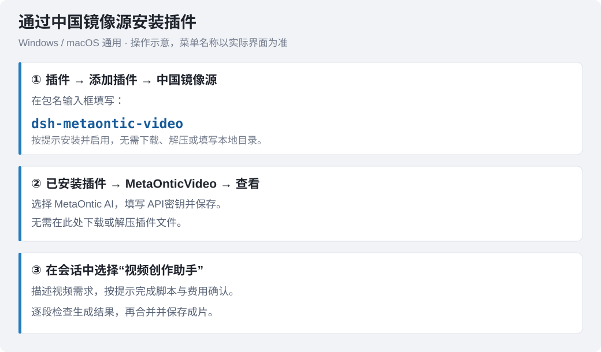
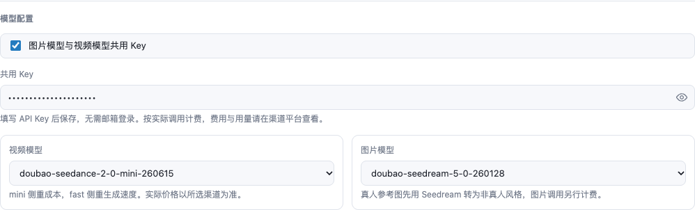
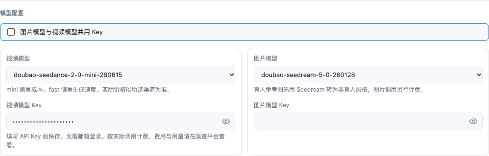
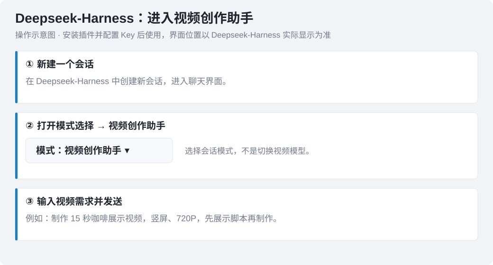
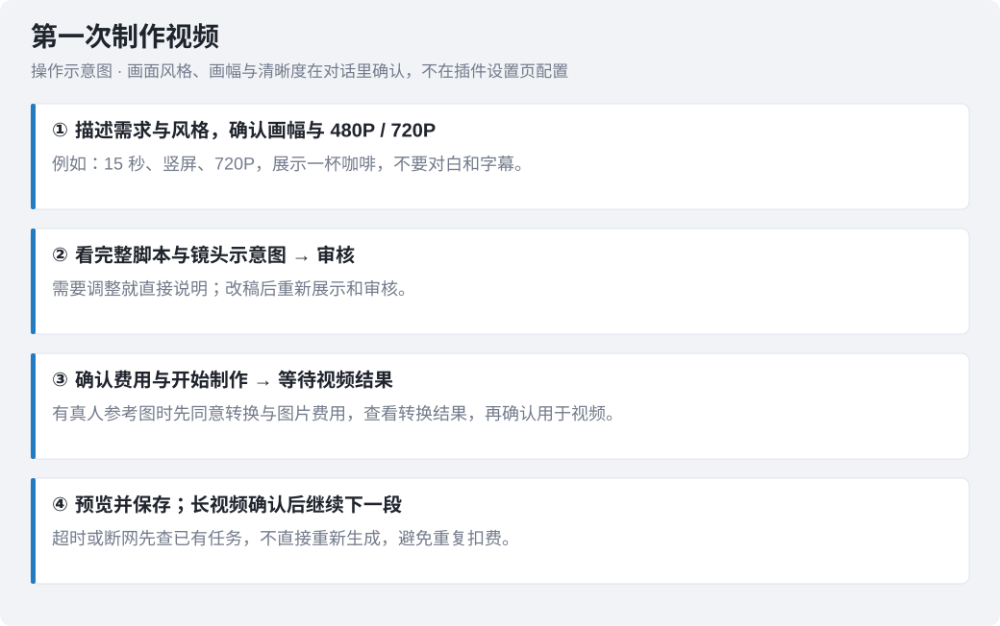
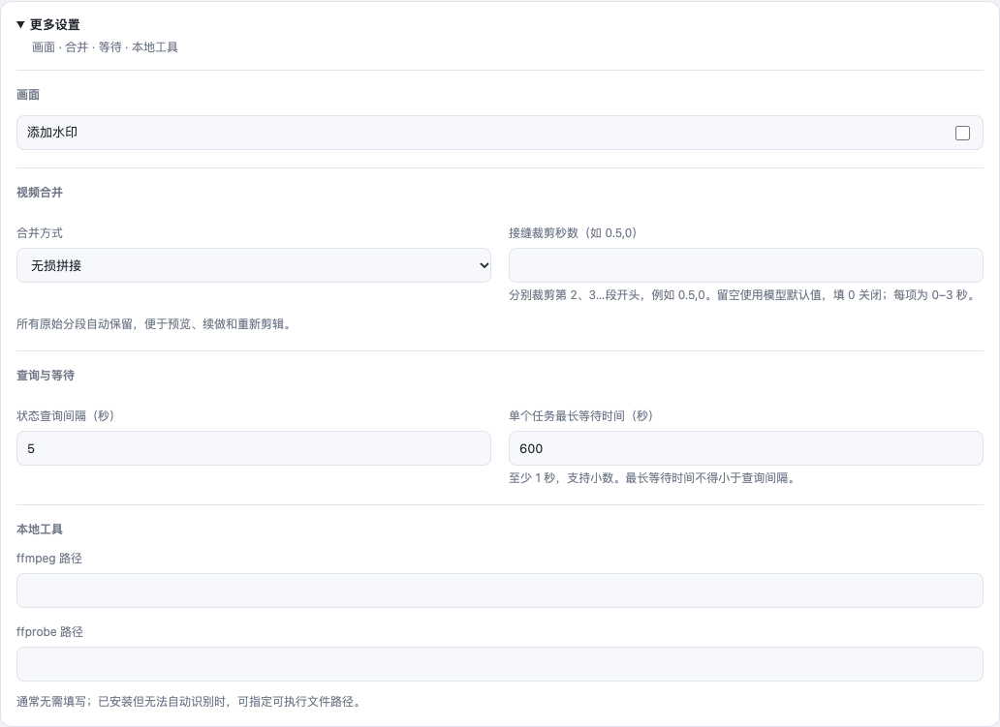

# MetaOnticVideo 安装与使用指南

先安装插件并配置 API密钥，再新建会话，将模式切换为“视频创作助手”，开始制作视频。API密钥配置配图来自插件真实组件的本地预览，使用模拟数据且密钥已隐藏；安装、会话与制作流程采用操作示意图，菜单名称以 Deepseek-Harness 实际界面为准。

MetaOnticVideo 是 DeepSeek Harness 的 AI 视频创作插件。使用 Seedance 2.0 制作超过15秒的视频时，会分段生成与续拍，逐段预览确认后在本地合并；完整制作流程见下文。

## 已安装旧名称插件时

插件列表中的 `metaontic-video` 与 `dsh-metaontic-video` 是不同的安装身份，不能直接用旧插件的“立即更新”代替包名迁移。新安装统一使用中国镜像源包名 `dsh-metaontic-video`。

1. 等正在执行的视频任务结束，备份 Harness 配置和任务资料，保留原安装目录。
2. 在插件管理中停用 `metaontic-video`，保留其配置与文件，不卸载、不删除任务目录。
3. 按下方中国镜像源步骤添加 `dsh-metaontic-video`，只启用新插件，核对原 API密钥配置、助手入口和已有项目后继续使用；配置未生效时先核对设置，不直接重提生成任务。

如果已经同时启用了两个名称，打开新版的插件设置页，等待所有视频任务结束，勾选确认后点击“切换并清理旧版”。插件先停用旧版，再通过 Harness 卸载旧安装包；配置、API密钥、任务和素材保留。也可以选择“仅停用旧版并切换”，稍后在正常设置页点击“清理旧版安装包”。清理失败不影响已切换的新版设置，页面会提供重试或插件管理操作说明；仅在宿主明确要求时重启或退出当前运行环境。更新或重启本身不会自动卸载旧包。安装状态查询超过约8秒会提示超时，可点击“重新检查”；超时查询的迟到结果不会继续停用或卸载。关闭迁移界面所属插件后，不再发起后续清理。工具加载阶段遇到安装状态异常会退避重试，最长每30秒检查一次，可按设置页提示排查。切换后核对 API密钥、助手入口和已有项目，历史任务仍按原任务 ID 查询或恢复，不重新生成。

## 1. 如何安装插件



### 安装前准备

本教程同时适用于 **Windows 与 Mac（macOS）**。先安装 DeepSeek Harness 桌面端，打开后确认能看到「插件」入口。MetaOnticVideo 需要在 Harness 中运行，不能作为独立软件打开。

使用 DeepSeek Harness 的中国镜像源，通过包名安装。无需下载解压、填写本地目录或自行安装 Git、Node.js、Python。多段视频合并所需的 FFmpeg 在使用时按提示检查即可。

### 中国镜像源安装

1. 打开 DeepSeek Harness，进入「插件 → 添加插件」。
2. 选择**中国镜像源**，在包名输入框填写下方包名。不要填写旧包名、Git 仓库地址或发布页网址。
3. 按界面提示安装并启用插件。
4. 在已安装插件列表找到 MetaOnticVideo（包名 `dsh-metaontic-video`），点击「查看」打开设置页。
5. 按第 2、3 节申请并保存 API密钥，再按第 4 节选择「视频创作助手」开始使用。

```text
dsh-metaontic-video
```

镜像源安装填写的是**包名**，不是 `.tgz` 地址，也不需要访问 unpkg 单文件链接。若暂时找不到包或安装失败，先按第 5 节排查镜像、网络和 Harness 安装状态，不要改用 Git 仓库、发布页、源码包、ZIP 或本地目录安装。

### 安装成功后

- 已安装插件列表中出现 MetaOnticVideo，包名为 `dsh-metaontic-video`，状态为已启用。
- 点击「查看」可以打开设置页，没有组件启动失败的提示。
- 在设置中选择 **MetaOntic AI**，填写 API密钥并保存。
- 在会话中选择「视频创作助手」；宣传视频助手默认关闭，宣传内容可先在插件详情的“包含的组件”中开启「宣传视频助手」，再到会话中选择。

只有 Harness 明确提示需要重启时才重启；配置、脚本、费用和生成结果分别按后续流程确认。安装报错先按第 5 节处理，不要通过提交付费生成任务来测试安装是否成功。

## 2. API密钥去哪里申请

使用自己申请的 **MetaOntic AI API密钥**。插件内不提供邮箱登录、账户余额查询或充值；账户额度和计费记录请在渠道平台查看。

需要自行申请 API密钥时，目前按以下入口操作：

**[https://ai.bileego.com](https://ai.bileego.com)**

1. 打开网站，注册并登录账号。
2. 按网站当前页面指引获取 API密钥。
3. 确认账户可用额度，以及该 API密钥是否有你准备使用的视频、图片模型权限。
4. 回到插件，选择 **MetaOntic AI**，按下一节填写并保存。

申请到 API密钥后，在插件的接入方式中选择 **MetaOntic AI**。

API密钥只填写在插件密钥输入框内，不要放进脚本或发到聊天中。


### 使用统计

插件设置页「高级设置 → 使用统计」可关闭匿名使用统计。开启时后台发送首次启用、启动、工具使用及视频任务结果，并附系统类型与版本、CPU 架构、取整内存、Harness 和插件版本；使用随机匿名安装标识，不发送对话、提示词、图片、视频或 API密钥。上报超时和服务端异常不会阻塞创作，关闭统计也不影响插件功能。首次启用统计不等同于下载安装次数。


## 3. 选择 MetaOntic AI 并配置 API密钥

1. 在接入方式中选择 **MetaOntic AI**。
2. 根据下面两种情况配置 API密钥。
3. 选择视频模型和图片模型，完成后点击保存。

切换接入方式并填好 API密钥后，点击一次保存并等待保存结果；后台正在同步时会等待同步完成。若提示保存失败，草稿会保留，请按提示处理后重试。

**情况一：两个模型共用一把 API密钥**



保持开启「图片模型与视频模型共用 API密钥」。在两个模型上方的 **共用 API密钥** 中填写从网站获取的 API密钥，再选择视频模型和图片模型。这把 API密钥必须同时支持你选择的两种模型。

共用开关和共用 API密钥位于两个模型上方。宽窗口中，视频模型与图片模型左右分组；窄窗口自动上下排列。

**情况二：视频和图片分别使用 API密钥**



关闭「视频 / 图片 / 文本模型共用 API密钥」：

- 在视频模型卡片下方的 **视频模型 API密钥** 中填写视频用 API密钥。
- 在图片模型卡片下方的 **图片模型 API密钥** 中填写图片用 API密钥。
- 在文本模型卡片下方的 **文本模型 API密钥** 中填写写脚本用 API密钥。

共用时上述三项合并成一张卡片里的 **共用 API密钥**；关闭后三个模型各自一张卡片，每张卡片都是「模型 + 该模型 API密钥」，排列顺序：共用开关 → 视频模型 + 视频模型 API密钥 → 图片模型 + 图片模型 API密钥 → 文本模型 + 文本模型 API密钥。

独立 API密钥未填写时，对应调用会停止并提示补填，不会自动改用其它模型的密钥：图片提交、查询和取件用图片 API密钥，写脚本用文本 API密钥，视频生成、重试和状态查询用视频 API密钥。三个模型仍沿用同一个 MetaOntic AI 接入地址。

**文本模型（写脚本）**

### 验证 API 连接

开启模型共用 API密钥并保存配置后，在共用 API密钥输入框右侧，点击小眼睛右边的「验证连接」；关闭共用时不显示验证按钮。视频、图片、文本会按各自实际使用的密钥检查接口鉴权响应和模型清单；有未保存修改时需先保存。鉴权失败、接口查询受限、超时、模型未列出会分别提示；模型清单返回403时，会补充只读令牌鉴权检查，鉴权正常仍会注明生成权限尚未验证，修改配置后旧结果清除。验证只发送只读请求，不提交生成任务；通过不代表实际视频、图像生成或口型效果已验证。接口未提供模型清单时，需按渠道说明进一步核对，不能直接判定密钥错误。

对话里的脚本创作使用 Harness 当前会话的模型，不需要为此配置插件文本模型。

三个模型仍沿用当前 MetaOntic AI 接入地址，分别填写 API密钥不代表分别配置接口地址。MetaOntic AI 按渠道账户实际调用计费。

## 4. 在 Deepseek-Harness 中开始使用



安装插件并保存 API密钥配置后，按以下步骤进入视频创作：

1. 在 Deepseek-Harness 中**新建一个会话**。
2. 打开会话的**模式选择**，将模式改为 **视频创作助手**。
3. 在输入框中描述你要制作的视频；需要参考图时，在会话中上传图片并说明用途。
4. 发送需求后，按助手提示确认清晰度、审核脚本，再确认是否开始制作。

这里的“视频创作助手”是会话模式，不是插件设置里的视频模型。若模式列表里没有它，先检查 MetaOnticVideo 是否已安装并启用，再重新打开模式列表；只有 Deepseek-Harness 提示需要重启时才重启软件。

### 左侧栏的「视频创作助手」入口

插件启用后，左侧栏会多出一行「视频创作助手」，图标是插件 logo。点开是插件自带的引导页，不用进对话也能看：

- **为什么用它**：一个是「新手也能上手」——不用研究提示词，说清创意、时长和画幅就能开始，脚本、分镜、生成、本机合并都由助手完成；另一个是「分段制作长视频」——超过单段上限时分段续拍，每段预览确认后继续，全部完成后在本机合并。
- **开始创作**：「新建视频创作会话」等同于新建会话后切到「视频创作助手」模式，直接开始；「打开插件设置」跳到设置页改接入方式与 API密钥；「使用说明」打开在线说明页。
- **使用流程**：说清创意 → 脚本分镜 → 逐段生成 → 本机合并。四步会依次点亮，只是操作顺序的演示，不需要在这里操作。

在插件设置的「界面显示」中，可开启或关闭「显示左侧视频创作助手」，默认开启，保存后立即生效。关闭后仍可从宿主插件管理打开设置并重新开启，已有会话和视频任务不受影响。入口开启却未出现时，先确认插件已启用；仅宿主明确提示时才重启。

### 第一次生成视频



切换到「视频创作助手」后，可以直接说：

> 帮我做一个 15 秒的咖啡展示视频，竖屏，720P，温暖自然，不要对白和字幕。先展示脚本，审核后再制作。

操作顺序：

1. 描述需求或提供完整方案。无论创意是否完整，助手都会先询问“帮我完善 / 保留原方案”，并与缺失的时长、画幅、清晰度一并确认；你已明确选择时不重复问。选择完善会补齐场景与道具、主体状态、动作层次、画面层次与节奏这类细节，保留主题、人物关系、核心情节和结尾，不偏离原创意；需要改变时会先征求你的同意。选择保留则按原方案整理为脚本与分镜。
2. 确认画面风格：没有指定风格时，助手会按你的创意推荐几款合适的画面风格，选一款即可；已经说清风格（例如“真实自然”“二维动画”）或说“你定”时直接采用，不会反复推荐。选定后助手按这个方向完善创意并写脚本。
3. 确认画幅与清晰度：画幅按 **16:9 横屏 / 9:16 竖屏** 确认，清晰度支持 **480P、720P**，都在脚本阶段选择，不在插件设置页配置。本次创意已写明时长、横竖屏或分辨率时直接沿用，只询问缺失项；例如“30秒竖屏720P”不会再问这三项。选择完善创意也不会清空这些规格；与时长、完善创意中需要确认的内容合并在同一轮提问。未回答或取消时不开始制作。时长未指定时，在完善创意的同一轮询问，提供15秒、30秒、45秒、60秒和“自定义时长”；选择自定义后输入4–3600秒的整数。已指定时长则不重复询问，未回答或取消时不继续制作。
4. 未提供图片且需要固定角色时，先选择是否生成角色参考图（图片单独计费）；同意后先看图审核，不同意则继续纯文生视频。随后查看完整脚本和正文里的镜头示意图，再确认脚本是否通过。图下会提供打开原图的链接；审核前会检查本轮是否已在正文插入本版分镜图——只登记到文件卡片不算让用户看到图，改稿后贴的还是上一版图也会被拦下——未完成时提示助手先补展示。若界面仍未显示图片，可打开原图并告诉助手补展示。示意图不是实际成片：它由插件在本地按脚本里的分镜表就地渲染，不排队等绘图模型、不额外计费；脚本也只在正文写这一次，插件同时把它落成 `script.md`，助手不会再另写一遍脚本文件或绘图代码。同一版脚本展示并保存后，分镜与审核会复用这份稿件，不再完整重复输出。分镜绑定当前项目和脚本内容，不能使用其他项目的图片；改稿后须生成并展示本版分镜。若审核提示正文或原图未完整展示，助手会依据工具返回的当前保存稿和原图补展示后重试，不重新建项目、改写脚本或自行转图。若脚本仍列有“待确认事项”或“待确认问题”，先逐项答复，助手将决定落实到新版脚本后再提交审核；答复会随项目保存，已回答的问题无需重复回答；直接删除问题不代表已经回答。取消、未回答或答非所问都不代表同意，事项答复也不等于脚本批准。
5. 费用在写脚本时一并算出：完整脚本末尾的“费用预估”一节会展示“火山官方方案”和“MetaOnticVideo插件方案”两项人民币基础估价，以及各自模型、分段和价格依据。火山官方方案统一按 Seedance 2.5 计算：单段上限 30 秒，不足 30 秒按实际秒数计，不凑整；超过 30 秒按 30 秒直出加逐段续拍如实列出，续拍计入上一段完整视频输入。费用明细逐段显示：首段为无视频输入，后续续拍为有视频输入；续拍按上一段完整视频时长加本段输出时长估算，并使用含视频输入单价；参考图片不算视频输入。最低用量补足尚未计入，图片处理、重试及独立配音另计，实际以账单为准。未核实账户折扣时不默认套用优惠；不同模型效果也有差异。脚本通过后，视频调用确认框会展示模型、画幅、清晰度、音频、本段时长、本段及剩余计划基础估价；点“允许”即开始制作，不再重复弹出开始制作问题。估价不可靠时会说明原因。按 MetaOntic AI 渠道账户实际调用计费。
6. 等待生成，预览并保存结果。等待时工具卡片显示按等待时长估算的进度、一条装饰用的小乌龟（跟着进度从左往右爬）和执行中的呼吸灯边框，它们只表示“还在生成”，不是上游的真实完成比例；确认成功后才到 100%。完成后会显示中转站结算的实际视频费用；分段暂停时显示已生成部分，尚未结算时显示“待结算”。可按原任务ID补查，不需要重新生成。图片处理及额外重做另计。长视频分段续做沿用已确认的清晰度，例如 30 秒选择 480P，后续分段的制作确认与生成均保持 480P。改稿后需要重新展示、审核并确认制作；普通改稿保留已确认清晰度，改变清晰度须重新确认。

### 宣传视频助手

宣传视频助手默认关闭。需要使用时，打开「插件 → 已安装插件 → MetaOnticVideo → 查看」，在“包含的组件”中开启“宣传视频助手”，然后在会话中选择它；不需要时可以关闭此组件，视频创作助手仍可正常使用。

插件详情的“包含的组件”中，视频创作助手使用蓝紫色场记板图标，宣传视频助手使用橙红色扩音器图标，可按中文名称区分。

制作产品、品牌、服务或活动宣传视频时，在会话模式中选择“宣传视频助手”。说明宣传对象、目标受众、已有卖点和素材即可；已写明的时长、横竖屏、分辨率会直接沿用，只询问缺失信息。

助手先确认是否需要完善创意，完善时保留原主题、情节与结尾，强化卖点的画面表达，不编造价格、优惠或产品功能。提供真实Logo、产品外观或界面素材有助于保持准确；没有素材时会说明使用示意，不承诺模型准确生成品牌文字。脚本、分镜、估价、费用确认、逐段预览与恢复操作与视频创作助手相同。

### 审核续拍过渡

续拍方式由脚本设计决定，不在插件设置中配置。请在审核时确认每段采用连续镜头还是切换近景、中景等景别，制作时按已确认的安排执行。

脚本先定义人物、道具与场景的统一称呼，再按事件顺序写清各镜头的动作、景别、视角、运镜和声音；视角由场景决定，平视是默认，说不清用途或场景没条件就不写，不为变化硬加；画质与约束词按需求填写，不能代替已确认的480P或720P参数。

长视频脚本会列出各段之间的过渡画面描述：前一段人物和动作停在哪里、下一段如何接上、镜头是否切换、声音如何延续。请与脚本一起核对；不满意时在制作前修改并重新审核。

例如：男子已放下茶杯，承接其抬眼动作，切到女子近景回应，室内环境声和配乐连续。脚本会同时说明主体、动作、场景、光影、镜头、风格、画质与约束；中景、近景、视角和运镜按剧情安排，不因分段自动换地点。过渡描述有助于表达衔接意图，仍需预览实际效果。

### 使用参考图

上传图片并说明用途，例如“用这张图保持人物外观”或“这张作为视频第一帧”。多图需说明各自对应的人物、商品或场景；参考图与首尾帧模式不能混用，尾帧必须配首帧。

真人参考图需要先确定非真人风格，并征得你对图片处理及其费用的同意。处理完成后先展示全部转换图，等你核对并确认后再用于视频。图片生成单独计费；效果不合适或仍像真人时停止，不使用原真人图重试。

视频接口返回明确真人限制时，也遵循“同意转换 → 看转换结果 → 确认重试”流程，最多重试视频一次；图片与视频重试分别计费。部分图片已完成时会保存结果，续做不从头处理。

图片模型为 `doubao-seedream-5-0-pro-260628`（旧型号已下线），能否调用以 API密钥的实际模型权限为准。

### 长视频与中断恢复

超过模型单次上限时，插件分段制作。每段完成先展示视频，再弹出“分段结果确认”窗口。选择“效果可以，继续下一段”后，才进入下一段的费用确认；选择暂停、关闭或未回答都不会继续。Seedance 2.0 单次 4–15 秒；2.5 保留兼容，但设置页暂不提供新候选。

结果审核通过后、提交下一段之前，会再弹一次费用确认框，写明第几段已经生成好、接下来做第几段、整条还差多少秒和大概还要花多少。点“允许”才继续；点“拒绝”就先停在这里，已经生成好的分段不用重做，之后可从原进度恢复；若上游链接已过期且本地文件缺失，需先核对原任务能否重新取件。

暂停后可说“接着刚才的进度继续，不要重做已完成片段”。超时、断网不一定表示生成失败，先查原任务，避免重新提交。

提交结果不明时插件会阻止重复提交。保留返回的任务或提交记录，让助手协助核对渠道记录；找到原任务则继续查询，只有你在渠道确认没有创建任务后才能解锁。不要通过修改参数或清除记录绕过防重。

未完成任务继续使用原来的参数与连接配置；请保留原接入方式、地址和 API密钥，不要在等待期间切换。同一份暂停进度不要同时续做多次。续做锁不会仅因等待时间变长而失效；只有确认本机原进程已退出时才能恢复，状态不明时保留锁。

### 对话范围与配置修改

这个会话只做视频创作：脚本与分镜、生成与接长、合并与交付，以及完成这些必需的配置指引和环境排查。与视频创作无关的话题（其他软件的安装排障、写代码、通用问答、闲聊等）不会展开——助手会说明这里只做视频创作，请回到视频需求。

视频目标时长在对话中确认或修改，修改后重新审核脚本，不需要到设置页操作。插件配置（接入方式、API密钥、模型、地址等）只能在设置页里改：打开「插件 → 已安装插件 → MetaOnticVideo → 查看」，改完点「保存」，宿主重载后生效。在对话里说“把模型改成 X”“把地址换成 Y”不会生效，助手只核对当前配置并引导你到设置页操作；助手不会向你索取或展示 API密钥。

### 更新插件

Windows 与 Mac 的更新入口相同。中国镜像源安装后可从插件内检查更新；历史本地目录链接安装会先停止直接替换，避免外部目录异常：

1. 等正在执行的视频任务完成。
2. 打开「插件 → 已安装插件 → MetaOnticVideo → 查看」，找到底部版本卡片，点击「检查更新」。
3. 发现更高的正式版本后，点击更新并再次确认，等待安装结果。
4. 按界面提示完成；只有明确提示需要重启时才重启，不需要先卸载。

插件查到更高的正式版本时，左侧栏「视频创作助手」最后一个字的右上角会亮起一个小红点（侧栏收起时，红点落在图标角上）。点这一行打开面板，面板顶部就是同一个更新入口，同样是「立即更新」→「确认更新到 vX.Y.Z」两步，确认后才安装；点「稍后再说」只压住这一版，出下一版还会提示。

普通更新可以选择“稍后再说”。如果显示当前版本已停止支持，需升级至提示的最低版本或更新的正式版，才能继续创作、生成图片或提交视频和续拍任务；此时不提供“稍后更新”。已有视频仍可用原任务 ID 查询和取件，图片可按原任务 ID 取件，已有项目可以读取、导出。更新仍需再次确认，不会自动安装、清除配置或重新提交任务。已经接收到的最低版本限制在断网时仍保留；首次离线且没有策略缓存时不会凭空拦截。

检查更新优先查询中国镜像源，同时检测 Gitee 和 GitHub 的正式版本；镜像同步延迟不会遮蔽仓库上的新版。确认更新后优先使用已核对目标版本的中国镜像包，镜像尚未同步或不可用时使用仓库成品包。在线更新需要能访问相应下载地址，使用对应版本 `.tgz` 成品包，不依赖 Git 拉取。下载失败时先保留现有插件和配置，核对网络后再处理，不要通过重置来解决下载问题。

插件详情底部的版本卡片提供“检查更新”。发现更高的正式版本后，点击更新并再次确认才安装。请等正在生成的视频结束后再更新，配置及已生成文件会保留，不需要先卸载。当前不提供版本选择或降级；在线安装使用对应版本成品包，当前版本不需要授权 esbuild 等构建工具的安装脚本。

## 5. 结果保存与常见问题

图片与视频生成完成后，可在工具结果卡片直接预览：图片点击放大，视频点击播放（不会自动播放）。优先读取本地文件，加载失败会尝试上游链接；超过两项可展开其他成果。宿主对本地文件有读取大小限制，大视频会尝试上游链接。若文件已移动、链接过期或编码不受支持，请打开原文件或下载后播放。暂停时也可预览已完成分段，审核确认后继续。

生成结果默认保存在当前会话工作目录下的 `metaontic-video/`，助手会展示视频，并在正文提供可点击的文件链接。脚本、分镜图、转换图片和恢复后交付的文件也会提供打开链接；图片还会在正文展示。超过15秒且分段生成时，等整条视频生成结束、成片在本机合并成功后，助手会把合并成片放在交付卡片的第一个位置，再依次列出第一段、第二段及后续全部分段。脚本、分镜示意图、参考图、转换图片、单段预览和暂停时的部分合并都算过程材料，在工具结果中预览并在正文展示，不放进交付卡片：卡片按本轮首次出现的顺序排列、超过四项还会折叠，中途登记会把成片挤到后面，事后补发也挪不回来。助手若把分段排在成片前面、漏掉成片或带上中间版本，插件会拦下这次登记并要求按提示重发；暂停、部分交付或还在等待查询时也不会登记卡片。成片另存为别的文件名或换到 final 等目录也照样按成片判定，不会因为改名而放过顺序错误。暂停时先交付已完成分段，合并失败时说明原因并保留分段。原始分段保留，脚本等资料通常在 `video-projects/<项目名>/`。如只返回上游链接，需在链接失效前保存。

多段本地合并需要 ffmpeg；缺少时可说“帮我检查并安装 ffmpeg”，确认安装后继续。高级设置中的合并、裁剪、等待时间通常保持默认即可；裁剪可能缩短成片，原始分段不删除。

需要重新配置时，可使用“重置插件”清除插件设置和已保存的 API密钥；已生成的视频不会删除。

| 遇到的问题 | 如何处理 |
| --- | --- |
| 网站申请的 API密钥不知道填哪里 | 选择 MetaOntic AI；共用时填“共用 API密钥”，不共用时分别填两个模型下方的 API密钥 |
| 图片提示缺少 API密钥 | MetaOntic AI 关闭共用后必须填写图片模型 API密钥并保存 |
| 写脚本提示缺少 API密钥 | 关闭共用密钥后要单独填写「文本模型 API密钥」并保存 |
| 提示无权调用模型或鉴权失败 | 检查对应模型的 API密钥是否正确、是否开通模型权限，修改后保存 |
| 生成前要确认什么 | 插件会写明本次调用的模型、清晰度、分段与预估费用，点「允许」才开始 |
| 只生成第一段 | 先在分段结果确认框选择继续，再单独确认下一段费用 |
| 断点记录损坏或提示内容不对 | 保留原进度目录、任务ID和已生成文件，先核对原任务与记录；不要删除记录后重新生成，以免重复提交。 |
| 超时、网络失败或提交结果不明 | 保留原任务与记录，先查询或核对，不直接重新生成 |
| 写脚本很慢、等很久 | 脚本由对话模型生成，内容越长等待越久；可查看阶段耗时，保留已有稿件后按原项目继续，不重复生成视频 |
| 只给脚本文件就要求审核 | 要求先完整展示当前版脚本和镜头示意图，再重新审核 |
| 展示脚本后没有弹出审核窗口 | 助手偶发在展示正文后提前结束这一轮，审核窗口不会出现。直接在对话里回一句（例如“重新弹一下审核窗口”或直接说修改要求）；助手会先补弹当前版脚本审核窗口，再按你的要求改稿。已展示的脚本、分镜图和已确认参数都不会丢 |
| 没有清晰度选项 | 清晰度在对话里的脚本阶段确认，支持 480P / 720P |
| 提示「本轮运行失败」并提到 JSON | 这是助手把工具参数写错了（常见是 480p、16:9 这类值少了引号），本轮没有真正调用视频模型、也没有产生费用；直接回一句「按原参数重试」，助手补齐引号后按原来的清晰度、画幅和时长重发即可 |
| 没想好画面风格 | 只说创意即可：助手会按创意推荐几款合适的画面风格，选一款后按这个方向完善创意与脚本；已经说清风格或说“你定”时直接采用，不会反复推荐 |
| 组件启动失败或提示缺少依赖 | 使用正式安装包；曾配置本地开发时，检查是否仍指向已删除的本地源码目录 |
| 想让助手在对话里改模型 / 地址 / API密钥 | 配置改动只在设置页生效：打开「插件 → 已安装插件 → MetaOnticVideo → 查看」改完保存。对话里的配置工具只读，助手只会核对当前配置并引导你去设置页 |
| 问和视频无关的问题 | 仅“视频创作助手”模式限定视频创作；标准模式可正常处理其他话题 |
| 保存失败 | 输入会保留。配置冲突时核对最新设置后重试；连接中断时先重新打开设置核对是否已保存。后台同步配置时会等待当前写入完成；仅在软件明确提示需要重启时重启 |

保存配置时，插件会一并保存接口地址、模型和请求路径；未填写地址时使用 MetaOntic AI 默认地址。密钥仅用于所选连接，图片独立密钥不会替代视频密钥。

排查处理缓慢时，可查看 `~/.dsh/logs/metaontic-video/日期/requests.jsonl` 中的阶段耗时；设置了 `DSH_HOME` 时日志位于该目录下。插件会记录调用、生成等待、下载、合并和费用查询耗时；脚本设计、示意图与等待用户确认由助手标记开始和结束，其中脚本保存为 `script.md` 时插件会自动结束脚本设计这一段，并另记一条 `script_saved`（文件名、新建或改写、字数与脚本版本）。这些是流程耗时，并非模型纯推理时间；只有开始记录时表示该阶段未完整结束。写脚本、画分镜本身是助手和模型在做事，不属于插件耗时。日志不包含密钥或完整提示词。日志按天保存，保留30天，历史日志总量达到50MB时清理最旧记录；单日达到5MB后停止追加。日志仅保留文件名，不保留完整用户路径。可请助手读取 `video_config`，查看 `logging` 中的写入失败、丢弃计数和最近写入时间；日志异常不会重新提交生成任务。Windows 默认目录为 `%USERPROFILE%\.dsh\logs\metaontic-video`。

设置页按生成参数、更多设置、界面显示分组。生成参数集中配置接入与密钥、模型；画面比例和声音开关移至更多设置，在宽窗口并排显示，窄窗口上下排列。API密钥在模型配置中填写，重置入口位于设置页底部。

所有布尔设置使用滑动开关，点击后保存生效。“更多设置”展开后分为画面与声音、画面、视频合并、查询与等待、本地工具、使用统计六组；本地工具路径单独占一行，便于查看和填写完整路径。



续拍时，插件会持续带上最初已审核的角色参考图，帮助保持人物外形。未单独指定角色图时沿用最初参考图或首帧；暂停后继续也保留同一套图。若图片已按你的确认转换为非真人风格，后续沿用获审并成功使用的转换图，不重复处理。纯文字起步且没有图片时不会自动生成角色图；需要固定形象时，可在需求阶段选择先生成角色图或提供已有图片，审核后用于视频。

纯文生视频需要固定人物外形时，助手会先询问是否生成角色参考图，并说明图片单独计费。选择直接文生视频就不生成图片；选择生成时先确认角色与画面风格，出图后先展示给你审核，满意后才用于视频首段与后续续拍。角色图费用与视频费用分开，生成角色图不代表同意开始制作视频。超时先查询已有图片任务，不重复出图；重画需再次确认费用。

需求阶段遇到需要固定外形的主体且没有图片时，插件会显示角色图选择，“直接文生视频”排在第一项；无固定主体的空镜跳过。选择“直接文生视频”后再确认视频费用；选择“先生成角色图”则先出图、审核后再制作。未回答、关闭或取消不会自动开始；同一项目的明确选择会保留，改提示词、时长或清晰度不重复问，新项目重新选择，已有参考图或续拍恢复不重复询问。

### 安装与更新故障排查（Windows / Mac）

| 现象 | 处理方法 |
|---|---|
| 镜像源找不到包或暂未同步 | 确认包名为 `dsh-metaontic-video`，检查 Harness 中国镜像源是否可用，并稍后重试；不要改用 Git 仓库、发布页、源码包或 ZIP。 |
| 提示包没有声明 `dsh.bundle` | 核对包名与安装来源，使用正式插件包；保留错误信息，不通过清空配置或任务排查。 |
| `ERR_PNPM_GIT_RESOLVE_FAILED` | 检查是否误用了 Git 仓库地址。新安装使用本指南的中国镜像源包名；无需配置 Git 地址重写或 SSH。 |
| `Lockfile passes supply-chain policies` 后又报错 | 这句表示供应链检查通过，实际失败原因在后面的错误。保留完整错误信息。 |
| 找不到本地插件或 `package.json` | 如果这是历史本地目录安装，先保留原文件并核对实际安装路径；新安装请使用本指南的中国镜像源包名，无需解压或选择目录。 |
| 镜像安装失败或超时 | 核对网络和 Harness 中国镜像源状态，确认填写的是包名 `dsh-metaontic-video`，稍后重试。不要使用 Source code、ZIP 或本地目录代替插件包。 |
| 中国镜像源安装提示「不是有效的插件包」 | 确认安装入口为中国镜像源，输入内容为包名 `dsh-metaontic-video`；不要填 `.tgz` 链接、ZIP、发布页、源码包或本地目录。 |
| 安装报 `ERR_PNPM_MISSING_TARBALL_INTEGRITY` | 插件安装目录里早先安装留下的 `pnpm-lock.yaml` 缺少校验值，新版 pnpm 会拒绝安装，与插件包本身无关。插件已安装时会每 2 秒检查一次并自动清理这条记录，更新失败后也会等清理完成自动重试；仍不行或尚未装上插件时，按本节「安装报 ERR_PNPM_MISSING_TARBALL_INTEGRITY」手动处理后再装。 |
| 提示找不到 `dsh` | 使用 DeepSeek Harness 桌面端的插件安装入口。 |
| 组件启动失败、`ERR_MODULE_NOT_FOUND` 或 Schema 错误 | 保留完整错误及插件版本，确认安装的是成品包；曾配置本地开发加载路径时需核对是否仍覆盖正式安装目录。不要先清除 API密钥或任务记录。 |
| `ERR_PNPM_IGNORED_BUILDS` / esbuild 脚本提示 | 核对是否误用了源码或旧 Git 安装来源，改用成品包；不要关闭供应链检查或直接批准未知构建脚本。 |
| 更新失败 | 保留现有插件、API密钥及已生成文件，记录目标版本与完整错误，检查附件可访问性；不要先卸载或重置。 |

排查时可以提供系统类型、插件版本、安装来源和完整错误文字；不要发送 API密钥、登录验证码或包含密钥的配置文件。

### 安装报 `ERR_PNPM_MISSING_TARBALL_INTEGRITY`

报错原文形如：

```text
Cannot install package "metaontic-video@https://…/metaontic-video-版本号.tgz":
its lockfile entry has no "integrity" field, so pnpm cannot verify the downloaded tarball.
```

这条报错与插件包本身无关。DeepSeek Harness 的插件安装目录里保留了早先安装生成的 `pnpm-lock.yaml`，其中这条 `.tgz` 地址的记录没有写入校验值；当前 pnpm 为防安装被篡改会直接拒绝，因此在删掉这条记录之前，换成在线地址、换成本地 `.tgz` 路径或重装旧版本都会同样失败。

处理步骤：

1. 保留现有插件、设置和任务，先等待数秒后重试。插件已安装且运行时，会每 2 秒检查本插件缺少校验值的历史记录，并在修改前保留锁文件备份；更新遇到该错误也会先等待清理再重试。
2. 如果仍报错，或插件尚未安装而无法执行自动清理，保留完整错误，请协助排查安装目录下的 `pnpm-lock.yaml`。Windows 通常为 `%USERPROFILE%\.dsh\profiles\desktop`，macOS 通常为 `~/.dsh/profiles/desktop`；设置了 `DSH_HOME` 时使用对应目录。
3. 手动修复时应先备份，只清理本插件缺少有效校验值的记录，不删除整份依赖清单、其他插件记录、API密钥或任务。完成后按本指南的中国镜像源步骤重新安装。

更换安装地址不一定能绕过历史锁文件里的坏记录。不要反复重装、关闭供应链校验，或批准无关安装脚本。

### 本地目录安装点击更新后目录变空

如果报错仍指向原先解压的 `package` 目录，请停止重复点击更新。用完整安装包恢复原路径下的整个目录，不只补一个空locale文件夹，也不要重置 API密钥或删除任务记录。

插件更新前会读取安装来源：本地目录链接、来源无法核实或元信息异常时停止，不调用安装器。它不会自动修复此前已变空的目录，也不会静默迁移旧安装。新装使用中国镜像源包名；旧目录安装迁移需要先核对实际加载路径和配置保留情况，不能只把目录恢复后再次点击旧版“立即更新”，也不要直接卸载。

自动检查覆盖成品安装及成品升级，不等于旧本地目录迁移或桌面界面的实机验收。遇到拦截请保留错误与安装来源，进一步排查，不绕过保护。

同一项目会保留审核结果；修改脚本或制作参数后需重新展示审核。脚本通过后直接进入视频调用确认，不需要连续回答两次“开始制作”。暂停时默认只下载展示新段，全部完成后再合并完整成片；想先看已有分段的累计效果，可以说“看一下目前合并的部分”，这只处理已有视频，不生成下一段。

仅在“视频创作助手”模式下，会话只提供视频创作服务；标准模式及其他模式保持原本用途。

视频进度提示仅在提交视频生成或续拍并等待生成结果时显示；脚本、审核、图片生成、单独查询状态、下载、合并和完成后的结果预览均不显示视频进度提示。

状态说明：“本段生成成功”表示上游返回成功状态及视频链接，不代表已下载或合并；“下载完成”表示本地已有文件，“合并完成”表示完整成片已在本机生成。查询超时或鉴权失败时只能确认暂未查到结果，不能据此判断生成成功或失败。续做会复用已完成分段，新生成的剩余分段仍需确认费用并计费；上游链接有效期以渠道为准，请及时保存。

续拍时，目标新增总时长与每段秒数分别确认；超过模型单段上限需安排多段，不会自动缩短。明确失败的分段按重新审核后的方案重试；已提交但状态不明的任务只查询原任务，不用新方案重提。重新下载或合并失败会保留已有成片，原始分段始终保留。

### 联系客服

在插件详情页顶部、与“卸载”同一行的左侧点击“客服”，打开企业微信客服页面，按页面提示咨询使用或接入问题。页面无法加载时，点击弹窗内“打开客服页面”在浏览器中打开；关闭弹窗不会修改插件配置。


### 服务连接验证未通过怎么办？

聊天出现“服务连接验证未通过”时，先到 Harness 的模型设置检查当前模型的 API密钥和中转地址；这是对话模型的连接配置，不要因此重置视频插件配置。视频工具返回401/403时，到插件设置检查当前接入的 API密钥是否填写正确并已保存。配置无误时可点击客服咨询渠道权限；鉴权失败不一定能证明密钥本身无效。已有视频任务的查询异常不代表生成失败，应保留任务ID，恢复原渠道鉴权后查询，不重新生成。

## 云智工坊 · 智能体平台

在会话模式中选择“云智工坊 · 智能体平台”，说明要完成的视频任务。总控按需求委派“视频创作助手”或“宣传视频助手”，仅允许一层调用。子任务开始后会显示任务 ID；这代表已启动，不代表视频已完成。需要补充要求或继续时沿用原子任务，不重复新建。

专业助手继续按原流程询问缺失信息、审核脚本与费用、逐段展示并审核视频。请在对应子任务的提问或费用确认界面回答；总控不会替你批准。任务完成后总控汇总真实成果链接，暂停、失败或待确认的部分会单独说明。宿主不提供委派工具时需先恢复该能力，不改用其他入口绕过。

停止子助手不等于取消已经提交到上游的视频生成，已提交任务仍可能计费；之后按原任务查询，不重新提交。

### 保存失败时如何处理

若提示“软件未接受本次保存，输入已保留”，先保留当前输入，不必重置 API密钥或重新申请。重新打开设置页，核对并保存；若仍失败，记录提示与操作步骤反馈。通信中断导致保存结果未确认时，先核对已保存状态，避免重复操作。


## 专业分阶段创作

需要先完成专业策划时，可向助手提出“分阶段创作剧本与分镜”。创作项目支持15秒至60分钟的规划，先审核创意，再审核剧本，然后整理人物、场景、分镜与提示词。创作规划本身不提交视频生成；实际制作仍使用原有脚本审核与费用确认流程。修改上游材料后，相关下游材料需更新。

专业创作审核完成后，可要求助手编译制作计划。60分钟以内的项目会按当前视频模型分段并关联制作项目；仍需选择角色图路线、审核制作材料和确认调用费用。创作改稿后须重新编译，不沿用旧版制作计划。全片时长上限为60分钟，每段仍遵守模型上限并逐段确认。

### 剧本、长片与独立复审

新专业项目的可读剧本根据场次、动作顺序和对白统一生成。要求修改一句对白或一场戏时，只调整相关内容，再确认修改后的剧本；不会另维护一份容易与分镜矛盾的正文。

10分钟以上作品先安排章节时长，再逐章写剧本、设计镜头和提示词。可以中断后继续未完成章节；修改前章时，受影响的后章需要更新。各章汇总后再确认完整剧本，部分完成不会显示为全片完成。

提示词完成后，助手会请求执行独立文本审核：它读取当前版本材料，不带创作聊天或作者自评，按主题、因果、人物、对白、画面细节和结尾核查依据。使用当前文本模型，调用按渠道计费，确认框会说明预计请求次数；不确认就保留材料，不发起文本请求。大型项目可能分章审核，已保存的审核结果可复用。文本审核通过不代表实际视频已经验收，视频费用与生成结果仍单独确认。

更换接入地址或目标模型后，助手会重新核对人物场景、分镜和提示词的适配。显示“适配器声明”不代表渠道已实测；真实成功样本只说明对应任务，不保证其他规格或最终效果。

### 指定局部修改

可以直接提出“只改这句对白”“调整第三个镜头的运镜”“给这个角色换装”“核查这段旁白的事实”或“适配另一模型”。助手会按请求选择编剧、分镜、人物、审核或提示词职责，保留未要求修改的内容；对象不明确时先请你确认。修改仍遵守当前项目审核流程，专业建议不代表已生成视频。

### 让脚本更有内容

创作时说明希望观众理解或感受到什么，并提供必须保留的事件、人物或产品事实。助手会围绕具体行动、信息递进和结尾变化组织脚本；风景与氛围内容以细节发现和声画变化推进。你可以要求“减少重复画面”“让人物行动更有动机”“对白更自然”或“结尾回应开头”，审核满意后再确认制作。

脚本应明确“核心表达、内容主线、结尾变化”。审核时先看影片要表达什么，再看每段是否用具体行动、细节或证据推进，最后核对人物站位、动作起止、反应与衔接是否清楚。可要求“主题更具体，但保留原故事”或“把这段画面展开成可执行动作”。

你可以提供一段喜欢的画面描述作为细致程度或风格参考。助手会提炼共同风格，并按时间、景别、主体姿态、动作过程、环境反馈、反应与声音展开脚本；不会自动照搬示例人物或情节。参考中的8K、渲染器等词不会替代实际清晰度选择，人物一致性和口型效果仍需生成后核验。


专业制作默认连续续拍。需要多地点剪辑时，可明确提出“独立镜头生成后剪辑”：助手先展示方案、逐镜时长和费用，再审核制作。每镜单独生成与计费，不输入上一段视频；人物一致性依赖参考图与逐镜检查。每镜完成后仍先展示、确认，再继续，最后直接拼接。专业项目编译后的提示词、分段和画幅等规格会在审核与生成前核对，改稿须重新编译。全片首帧只用于第一个镜头，尾帧只用于最后一个镜头；可以为各镜头分别提供首尾帧，换地点不会重复套用同一构图。只调整视觉风格时保留创意和剧本确认，重新检查人物、场景与分镜；改变故事基调仍需重新确认。合并时为缺音轨的片段补静音，保留其他片段的声音；音频合并失败会保留原片与已有成片，恢复后只重试合并。

分镜示意图由插件根据当前制作脚本本地绘制，助手展示图片与原图入口后再请求审核，不需要另行付费出图。新专业项目要求创意有可见细节、每场有行动及状态变化、审核评分有依据。对白超时估算会提示复核，不强迫加快语速；地点、道具与场景状态可定向修改。

项目操作异常中断后，可请助手“诊断项目锁”。系统只允许恢复已证实进程退出的本机锁，仍在工作或状态不明的锁会保留；等待审批时仍可读取最后保存版本。

## 专业脚本创作

直接说明想写的故事、时长和风格即可。助手先整理创意供确认，再编写完整场景剧本；剧本确认后才继续人物场景、导演分镜和视频提示词。改稿说明要改的对白、人物或场景，助手沿用未受影响内容。可要求导出可读创作材料与版本清单；实际视频制作还需审核制作脚本、确认费用并逐段查看结果。

脚本会在关键动作处写清注意对象、反应与动作反馈，并在生成段边界安排完整对白和可识别的动作落点。续拍应核对上一段实际持物、站位与声音状态，避免重复动作；单段和最后一段保留完整结尾。上述约束有助于执行，不等于保证接缝、表演或声音一致，仍需预览审核。

创意提案会说明核心看点、人物冲突、情节推进、反转或情绪落点、可视化细节和观众记忆点，优先复用现有人物、场景和道具。新增重要情节在创意审批前展示，不改变你指定的核心情节。无人物或非剧情内容以核心问题和观察推进表达，不硬加冲突。

场景剧本以行动目标、动作、有效对白、反应和场景结果推进；短视频控制事件数量，长视频通过关系、伏笔和细节递进。分镜从已有剧情选择动作、构图、道具互动及反应，不把所有对白都变成正面说话；15秒作品也会为关键反应与笑点保留时间。

## 选择作品类型

专业对话创作还可分别指定题材、作品形式、创作目的和视觉策略，例如“纪录题材＋访谈形式＋科普目的＋MiniDV风格”；情绪基调和具体视觉要求单独保留。系统按角色应用对应方法，发现冲突会提示处理；修改后需重新审核创意与剧本。

可向助手说明要做剧情短片、情景喜剧、生活Vlog／氛围片、纪录／知识片、产品广告或品牌／地域宣传。类型决定内容组织与审核方法，视觉风格可另选，例如“生活Vlog，千禧MiniDV质感”。未明确时助手推荐方向供确认，不擅自当作剧情片。新专业项目在创意批准前确定类型；旧项目沿原流程，需切换时再明确提出。

修改作品类型会保留现有材料，但标为待更新并重新确认创意、剧本，不自动重做视频。不同类型分别检查动机与因果、铺垫与笑点、观察与生活细节、证据来源、卖点依据或地域品牌辨识度；无对白和安静内容不会被强加冲突。实际生成效果仍需预览审核。


## 专业项目审核与展示

创意和正式剧本分别确认，审批窗口展示当前稿的可读内容。批准前核对主题、情节、对白、时长和风险；需要修改时选择修改，保留原材料后调整。创意批准不代表剧本、视频费用或生成结果已批准。

镜头列表、分镜表是文字材料，不能代替分镜示意图。进入制作脚本审核前，助手应展示当前稿的构图草图，包含主体站位、场景、关键道具与动作方向，并提供原图入口。默认使用本地免费示意图，属于拍摄构图参考，不能代表视频最终效果。看不到图片时请要求补展示同版图，不必重新生成视频。

项目目标模型与当前制作模型不一致时，先核对插件设置与项目要求，再明确调整项目制作规格。只改变目标模型时保留创意和剧本批准，重新检查人物场景、分镜与提示词的模型适配；实际视频调用仍单独确认费用。

脚本阶段会保留当前稿和下一阶段所需资料，减少重复读取。内部格式或引用错误应由助手修正后再提交，无需自行编辑 JSON；如果修改涉及已批准的内容，仍须重新确认。等待较长时可询问当前阶段，避免反复新建项目或重做已有成果。

专业项目出现工具返回格式错误时，项目可能已经保存。助手应先核对已保存状态，不应重复创建项目、把错误当作专业通道不可用或擅自跳过创意与剧本批准；只有你明确选择更换流程才切换。

专业创作的创意和剧本各通过插件审核窗确认一次，不需要先回答另一份批准问卷。创意批准后助手继续编写并保存剧本；若对话中断，在原会话发送“继续生成剧本”，助手读取原项目并沿用已批准创意。尚未保存的剧本不视为已完成。
