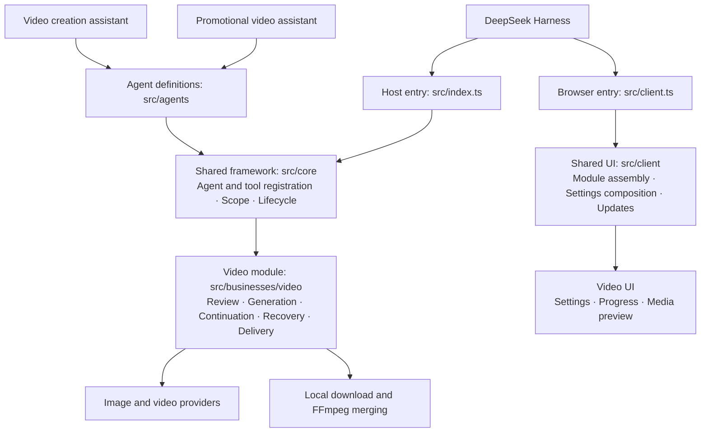

# MetaOnticVideo

[简体中文](./README.md)

A DeepSeek Harness plugin for **beginner-friendly video creation and a low-cost long-video workflow**.

## Start creating videos quickly

Describe what you want to make and follow the assistant through your first video, without first learning prompting or editing workflows.

1. **Share your idea**: start with a brief thought or a complete concept. Any refinement stays true to your original idea.
2. **Review the script**: read what will be filmed, ask for changes in plain language, then confirm production.
3. **Watch the result**: preview the generated video and keep the finished file locally.

For example: “Make a 30-second vertical 720P video showing a peaceful lake at dawn.” Duration, orientation and resolution already supplied are reused; only missing details are requested.

## A low-cost long-video workflow

Use **segment generation → continuation → local merging** to make videos beyond the model’s single-call duration limit.

- Review each result before continuing to the next segment.
- Keep and reuse completed segments, pause and resume saved progress, and avoid starting over.
- Merge completed segments locally with FFmpeg while retaining the original clips.

Bring your own API key. Image and video calls are billed by the chosen provider, with cost confirmation before each new segment.

## Online installation

Paste an online installation URL into Harness → Plugins → Add plugin. Windows and macOS use the same package.

Gitee:

```text
https://gitee.com/hackloop/metaontic-video/releases/download/v3.20.2/metaontic-video-3.20.2.tgz
```

GitHub mirror:

```text
https://github.com/wxsimon2022/metaontic-video/releases/download/v3.20.2/metaontic-video-3.20.2.tgz
```

Open plugin settings, choose **MetaOntic AI**, enter your API key and save. Select **视频创作助手** in a conversation to begin; **宣传视频助手** is also available for product, brand or event content. Both assistants share the production workflow. Standard mode remains general-purpose.

[Online user guide](https://ai.mybfs.cn) · [Report an issue](https://github.com/wxsimon2022/metaontic-video/issues) · [Changelog](./CHANGELOG.md) · [Development](./docs/engineering/development.md)

## Plugin architecture

Agents declare their business dependencies; the shared framework assembles them. Both existing assistants use the video module. New business modules can be added independently.



[Module structure and adding agents or businesses](./docs/engineering/structure-refactor.md)

See [LICENSE](./LICENSE).

### Infinite Canvas

The video creation panel can install and open the original [`dsh-infinite-canvas`](https://github.com/NINKCH/dsh-infinite_canvas). Click Generate or Regenerate inside an image/video node to review the plan, approve costs and review results directly on the canvas, without opening or sending a chat. API keys stay in MetaOnticVideo. Each video node runs one segment (up to 15 seconds for 2.0 or 30 seconds for 2.5); review the result before extending it. Images currently support one square image per call. Results are added to the original canvas; failed publishing can be retried without generating again. Native batch runs, context-menu runs and other generation tools retain their original configuration. The assistant-based video_canvas workflow remains available for full script creation. Supports original version 0.20.1 with a configured data root; existing installations are preserved.

Video creation now automatically creates an original canvas project, synchronizes the full script and production segment plan after review, and publishes generated media using the project binding (including resume). No manual node creation is required. Enable original canvas 0.20.1 and configure its data root first. Existing script, cost and segment reviews remain required. Unavailable canvas synchronization preserves the creation project and can be retried through project status.
