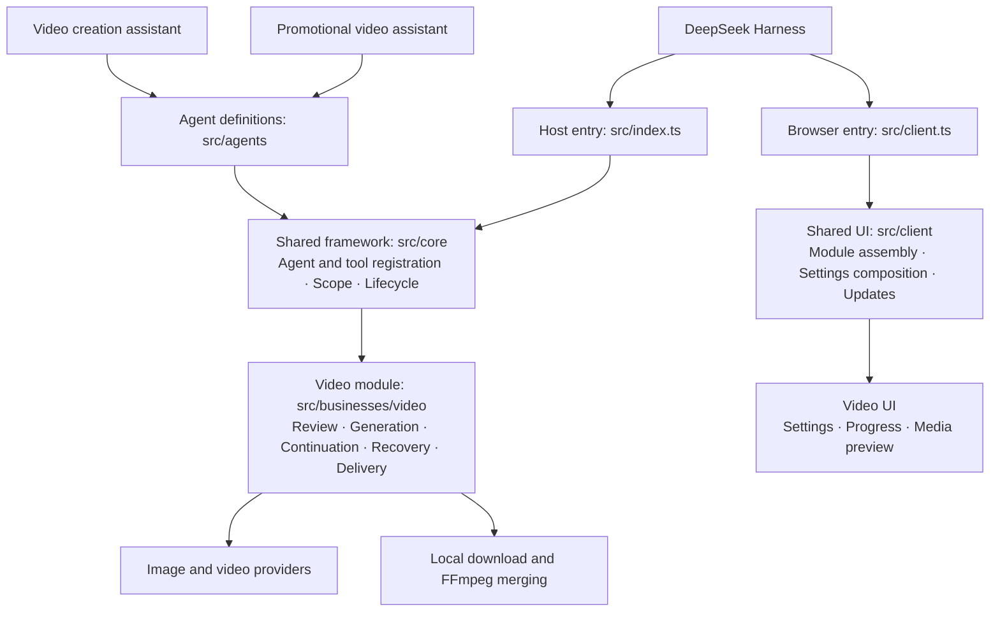

# MetaOnticVideo

[简体中文](./README.md)

A DeepSeek Harness plugin for **beginner-friendly video creation and a low-cost long-video workflow**.

## Start creating videos quickly

Describe what you want to make and follow the assistant through your first video, without first learning prompting or editing workflows.

1. **Share your idea**: start with a brief thought or a complete concept. Any refinement stays true to your original idea.
2. **Review the script**: read what will be filmed, ask for changes in plain language, then confirm production.
3. **Watch the result**: preview the generated video and keep the finished file locally.

For example: “Make a 30-second vertical 720P video showing a peaceful lake at dawn.” Duration, orientation and resolution already supplied are reused; only missing details are requested.

## A low-cost long-video workflow

Use **segment generation → continuation → local merging** to make videos beyond the model’s single-call duration limit.

- Review each result before continuing to the next segment.
- Keep and reuse completed segments, pause and resume saved progress, and avoid starting over.
- Merge completed segments locally with FFmpeg while retaining the original clips.

Bring your own API key. Image and video calls are billed by the chosen provider, with cost confirmation before each new segment.

## Online installation

Paste an online installation URL into Harness → Plugins → Add plugin. Windows and macOS use the same package.

Gitee:

```text
https://gitee.com/hackloop/metaontic-video/releases/download/v3.22.0/metaontic-video-3.22.0.tgz
```

GitHub mirror:

```text
https://github.com/wxsimon2022/metaontic-video/releases/download/v3.22.0/metaontic-video-3.22.0.tgz
```

Open plugin settings, choose **MetaOntic AI**, enter your API key and save. Select **视频创作助手** in a conversation to begin; **宣传视频助手** is also available for product, brand or event content. Both assistants share the production workflow. Standard mode remains general-purpose.

[Online user guide](https://ai.mybfs.cn) · [Report an issue](https://github.com/wxsimon2022/metaontic-video/issues) · [Changelog](./CHANGELOG.md) · [Development](./docs/engineering/development.md)

## Plugin architecture

Agents declare their business dependencies; the shared framework assembles them. Both existing assistants use the video module. New business modules can be added independently.



[Module structure and adding agents or businesses](./docs/engineering/structure-refactor.md)

See [LICENSE](./LICENSE).

### Infinite Canvas

The workflow canvas is built into this plugin: no other canvas plugin and no canvas data root are required.

With the "Workflow canvas" switch turned on in settings (off by default), the left sidebar shows the "MetaOnticVideo workflow canvas" row and video creation also automatically creates a workflow canvas: the project is created once requirements are confirmed, the full script and production segment plan are synchronized after review, and generated media is published back automatically. Turning the switch off hides the sidebar row and the canvas page together; existing canvases and results stay in the plugin data directory. Open the workflow canvas as its own page from the "MetaOnticVideo workflow canvas" row in the left sidebar (the video panel no longer embeds a copy); it shows nodes and edges. All canvas operations live above the canvas: the first row holds the canvas name plus new-canvas, add-node, the edge-ordered "Make <node>" action with a flow progress readout, write-from-script (turn a written or model-generated script into script/storyboard/segment video nodes, previewing the split first; the text model is picked from the same relay-model dropdown as the video and image models, and gets its own API key field once you turn the shared key off), refresh, tidy layout (re-arranges nodes along the edges without touching content or edges), reset view, export and delete actions, and the second row (Choose canvas) lists every canvas for switching. Pending production nodes are marked with a dashed outline; each step still needs its own plan check and separate cost confirmation. Drag the background to pan, scroll to zoom, drag nodes to move (a multi-selection moves together), Shift+drag to marquee-select and Shift+click to add to the selection, and create a canvas (a name is required and duplicates are refused), rename it by double-clicking its name, delete it after confirmation, add or duplicate text/image/video nodes, edit their content, connect or disconnect edges, delete nodes, or export the canvas as JSON. Use Import image to copy your own pictures into the canvas data directory as assets; the production dialog of a video node lets you set an upstream asset port to First frame or Reference image, so both "start from a picture" and "generate from references" work; a real-person photo is rejected by the video endpoint, so first turn it into a non-photorealistic 2D animation image with an image node and use that as the first frame. Once every segment has a result, Merge film joins them in edge order into one film you can preview or download right on the canvas; merging only reads existing results, never regenerates anything, costs nothing extra, and names the missing segment when one is not ready. To confirm one whole chain and then generate it segment by segment, use Chain: the plugin lists every pending video node in edge order with its prompt, duration, ratio, resolution and a total estimate, and only starts after you confirm the plan and the cost; each segment stops for your review, and you continue with "Confirm and continue to the next segment" or stop the chain at any time, keeping every finished segment on the canvas. Nodes, edges, reference assets and results are stored in the plugin's own data directory (`~/.dsh/metaontic-video/canvas`).

Press Make on an image or video node to run the whole step inside the canvas: fill in the content, ratio, duration and resolution, review the plan and estimated cost, then confirm the plan and the cost separately before any model call. Review the result on the canvas and, once approved, extend it into the next segment. Cost and result review stay inside the canvas with no chat round-trip, and API keys stay in MetaOnticVideo. Each video node runs one segment (up to 15 seconds for 2.0 or 30 seconds for 2.5); images currently support one square image per call. Failed publishing can be retried and an unconfirmed task can only be queried, never regenerated. The assistant-based video_canvas workflow remains available for full script creation, and existing script, cost and segment reviews remain required.
