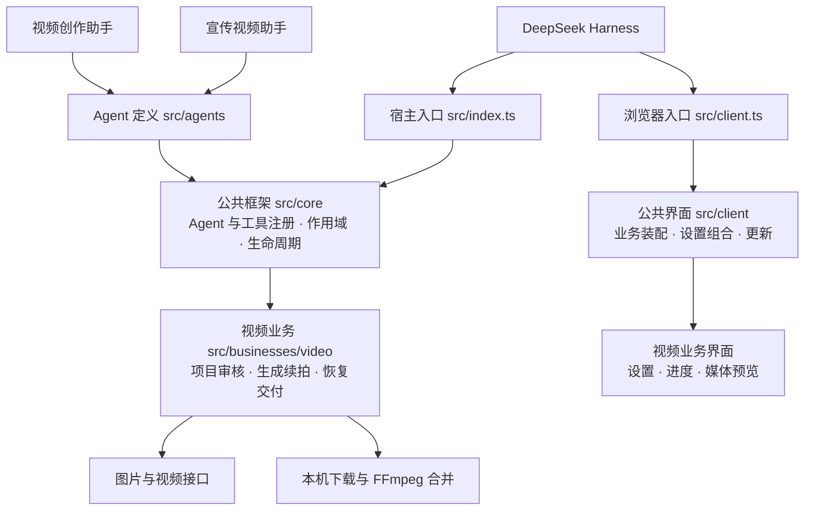

# MetaOnticVideo

[English](./README.en.md)

DeepSeek Harness 视频创作插件：**新手快速上手，低成本制作长视频。**

## 新手快速上手视频创作

不用先研究提示词或剪辑流程，把想拍的内容说出来，跟着助手完成第一条视频。

1. **说想法**：一句灵感或完整创意都可以，助手帮你整理；需要完善时沿着你的原意补充。
2. **看脚本**：先看懂要拍什么，再用口语提修改意见，满意后确认制作。
3. **看结果**：生成后直接预览，完成的视频保存到本机。

例如：“帮我做一条30秒竖屏720P的视频，表现清晨湖面的宁静。”已写明的时长、横竖屏和分辨率直接沿用，只询问缺失信息。

## 低成本长视频生成方案

通过 **分段生成 → 逐段续拍 → 本机合并**，把超过模型单段上限的创意做成长视频。

- 每段先看结果，确认后再续拍下一段，按段推进制作。
- 已完成的分段保留复用，可以暂停后接着做，避免从头重复生成。
- 全部分段完成后，用 FFmpeg 在本机合并，原始分段一并保留。

需要自行配置 API密钥；图片与视频按渠道实际用量计费，每段新增生成前确认费用。

## 在线安装

在 Harness「插件 → 添加插件」中粘贴在线安装链接。Windows 与 macOS 使用同一个成品。

Gitee：

```text
https://gitee.com/hackloop/metaontic-video/releases/download/v3.20.2/metaontic-video-3.20.2.tgz
```

GitHub 同版备用：

```text
https://github.com/wxsimon2022/metaontic-video/releases/download/v3.20.2/metaontic-video-3.20.2.tgz
```

安装后打开插件设置，选择 **MetaOntic AI**，填写 API密钥并保存；在会话中选择 **视频创作助手** 开始。制作产品、品牌或活动内容时，也可选择 **宣传视频助手**。这两个助手使用相同的制作流程，标准模式保持通用用途。

[在线使用说明](https://ai.mybfs.cn) · [问题反馈](https://github.com/wxsimon2022/metaontic-video/issues) · [完整更新记录](./CHANGELOG.md) · [开发说明](./docs/engineering/development.md)

## 插件架构

Agent 声明业务依赖，公共框架负责装配；两个现有助手共用视频业务。新增业务可独立接入，不必修改视频制作流程。



[目录结构与新增 Agent / 业务接入方式](./docs/engineering/structure-refactor.md)

<details>
<summary>最新更新</summary>

## v3.20.2 更新内容

### 优化

- 常规体验优化。

## v3.20.1 更新内容

### 优化

- 鉴权异常提供设置检查与客服入口，不再直接判定密钥无效；视频接口401/403准确提示鉴权失败。

</details>

许可见 [LICENSE](./LICENSE)。

### 流程画布

流程画布是本插件自带的组件，不需要安装任何其他画布插件，也不需要填写画布数据根目录。

在设置页打开「自动创建流程画布」（默认关闭）后，普通视频创作会自动创建流程画布：确认创作需求后建立项目，脚本审核后同步完整剧本与各制作段计划，生成成果自动回填。在左侧栏点「MetaOnticVideo流程画布」打开这个独立页面（视频创作面板里不再内嵌画布），可以直接查看节点与连线。画布操作都在上方：第一行是画布名与新建画布、新建节点、按连线顺序驱动的「制作「节点名」」以及写脚本、刷新、美化布局、重置视图、导出、删除等操作（旁边显示流程进度），第二行「选择画布」列出所有画布并可随时切换。未完成的制作节点用虚线框标出，点「制作」按顺序逐个做，每段仍要先核对方案、单独确认费用。想从脚本开始就点「写脚本…」：写一句「想拍什么」让文本模型（设置页下拉选的文本模型，与中转站在售型号一致，按文本用量单独计费；关闭共用 API密钥后可单独填它自己的密钥）写成剧本与分镜表，也可以直接自己写脚本、或加一个「+ 剧本」节点手写；点「预览分段」先看清会被拆成几段、每段多少秒、每段提示词是什么，确认后再「生成制作节点」，插件按分镜表或句子段落把剧本、分镜与每段视频节点一次铺好并自动连线排版。拖动空白处平移、滚轮缩放、拖动节点移动（选中多个可整组移动），Shift+拖空白框选、Shift+点节点加选，新建画布（必须命名，重名或空名会被拒绝）、双击画布名就地重命名、删除画布（二次确认）、新建或复制文本/图片/视频节点、编辑内容、连线与断开、删除节点，节点摆乱了点「美化布局」按连线一键重排（只挪坐标，不改内容与连线），也可以把当前画布导出成 JSON。整条链路想一次确认、逐段生成就点「连拍」：插件按连线顺序排好每段的提示词、时长、画幅、清晰度与整条链路的预估合计，确认方案与费用后开始，之后每段出成果都停下来等你审核，确认无误才「确认并继续下一段」，也可以随时「停止连拍」，已生成的成果都保留在画布上。节点与连线、参考素材和成果都保存在插件自己的数据目录（`~/.dsh/metaontic-video/canvas`）。

图片/视频节点点「制作」即可在画布内完成整段制作：填写本次内容与画幅、时长、清晰度，查看制作方案与预估费用，分别确认制作方案与费用后才会调用模型；完成后在画布内查看并审核成果，审核通过后可续拍下一段。费用与结果审核都在画布内完成，不跳转、不发送聊天请求；API密钥沿用本插件设置，不复制给画布。每个视频节点执行一段（2.0 最长15秒、2.5最长30秒），图片暂支持1:1单张。回填失败只补传、查询不明只查询原任务，都不重新生成。也可在助手中使用 `video_canvas` 走完整脚本创作流程；脚本审核、费用确认和分段成果审核仍按原流程执行。
