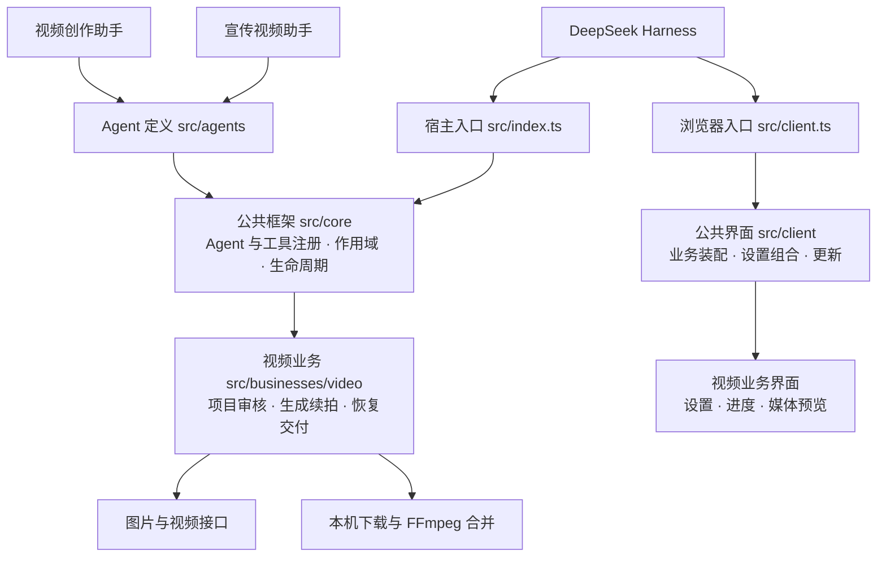

# MetaOnticVideo

[English](./README.en.md)

DeepSeek Harness 视频创作插件：**新手快速上手，低成本制作长视频。**

## 新手快速上手视频创作

不用先研究提示词或剪辑流程，把想拍的内容说出来，跟着助手完成第一条视频。

1. **说想法**：一句灵感或完整创意都可以，助手帮你整理；需要完善时沿着你的原意补充。
2. **看脚本**：先看懂要拍什么，再用口语提修改意见，满意后确认制作。
3. **看结果**：生成后直接预览，完成的视频保存到本机。

例如：“帮我做一条30秒竖屏720P的视频，表现清晨湖面的宁静。”已写明的时长、横竖屏和分辨率直接沿用，只询问缺失信息。

## 低成本长视频生成方案

通过 **分段生成 → 逐段续拍 → 本机合并**，把超过模型单段上限的创意做成长视频。

- 每段先看结果，确认后再续拍下一段，按段推进制作。
- 已完成的分段保留复用，可以暂停后接着做，避免从头重复生成。
- 全部分段完成后，用 FFmpeg 在本机合并，原始分段一并保留。

需要自行配置 API密钥；图片与视频按渠道实际用量计费，每段新增生成前确认费用。

## 在线安装

在 Harness「插件 → 添加插件」中粘贴在线安装链接。Windows 与 macOS 使用同一个成品。

Gitee：

```text
https://gitee.com/hackloop/metaontic-video/releases/download/v3.24.1/metaontic-video-3.24.1.tgz
```

GitHub 同版备用：

```text
https://github.com/wxsimon2022/metaontic-video/releases/download/v3.24.1/metaontic-video-3.24.1.tgz
```

安装后打开插件设置，选择 **MetaOntic AI**，填写 API密钥并保存；在会话中选择 **视频创作助手** 开始。制作产品、品牌或活动内容时，也可选择 **宣传视频助手**。这两个助手使用相同的制作流程，标准模式保持通用用途。

[在线使用说明](https://ai.mybfs.cn) · [问题反馈](https://github.com/wxsimon2022/metaontic-video/issues) · [完整更新记录](./CHANGELOG.md) · [开发说明](./docs/engineering/development.md)

## 插件架构

Agent 声明业务依赖，公共框架负责装配；两个现有助手共用视频业务。新增业务可独立接入，不必修改视频制作流程。



[目录结构与新增 Agent / 业务接入方式](./docs/engineering/structure-refactor.md)

<details>
<summary>最新更新</summary>

## v3.24.1 更新内容

### 优化

- 匿名使用统计口径更准确，画布等工具的调用会被计入，测试版不再计入统计。

## v3.24.0 更新内容

### 新增

- AI 写脚本的分镜表增加镜号、镜别、运镜三列，画面列要求写全主体、动作、环境、光线与氛围。

### 优化

- 分镜表里的镜别与运镜会带进每段提示词，画布分镜节点按镜别·运镜加画面详情显示。

## v3.23.0 更新内容

### 新增

- 设置页新增「自动创建画布」开关（默认开启），可关掉自动建图，只在画布内选中的节点上联动。

### 优化

- 流程画布拆成「流程画布」与「自动创建画布」两个开关，先打开流程画布才会出现自动创建。

## v3.22.0 更新内容

### 新增

- 流程画布可直接导入自己的图片作素材，连成首帧或参考图参与制作。
- 全部段落出成果后可一键合成成片，在画布内预览或下载。

### 优化

- 流程画布开关关闭后左侧栏不再显示画布入口，已有画布与成果保留。

## v3.21.0 更新内容

### 新增

- 内置流程画布：独立页面管理画布与连线，图片视频节点直接制作、续拍。
- 画布内写脚本铺开剧本分镜，「连拍」一次确认后逐段生成并逐段审核。

### 优化

- 不再需要第三方画布插件；自动创建画布默认关闭，文本模型可单独配密钥。

## v3.20.2 更新内容

### 优化

- 常规体验优化。

## v3.20.1 更新内容

### 优化

- 鉴权异常提供设置检查与客服入口，不再直接判定密钥无效；视频接口401/403准确提示鉴权失败。

</details>

许可见 [LICENSE](./LICENSE)。

### 流程画布

流程画布是本插件自带的组件，不需要安装任何其他画布插件，也不需要填写画布数据根目录。

画布在设置页由两个开关控制：先打开「流程画布」（默认关闭），左侧栏才出现「MetaOnticVideo流程画布」入口；打开后下方多出「自动创建画布」开关（默认开启），开启时普通视频创作会自动创建流程画布——确认创作需求后建立项目，脚本审核后同步完整剧本与各制作段计划，生成成果自动回填，关掉它就只在你明确选中画布节点时联动。关掉「流程画布」开关，左侧栏入口与画布页一起隐藏，已有画布与成果仍保留在插件数据目录。在左侧栏点「MetaOnticVideo流程画布」打开这个独立页面（视频创作面板里不再内嵌画布），可以直接查看节点与连线。画布上排着七张「流程阶段」卡（需求确认 → 脚本审核 → 分镜确认 → 素材准备 → 费用确认 → 逐段制作 → 合成成片），卡间用虚线箭头连成一条流程：文案与状态跟着创作项目和画布成果自动更新，当前阶段用虚线框标出，每张卡上带这一步的主行动，且跟着进度换文案——①「填需求」（建好后是「改需求」）、②「写脚本」（写好是「确认脚本」，通过后是「看剧本」）、③「生成分镜」（有镜头后是「看分镜」）、④「准备素材」（角色图、首帧或参考图；建卡片或补素材时会把素材反绑到它服务的制作段，卡上会写清有几张还没接上）、⑤「看估价」（列出每段提示词与整条链路的预估合计）、⑥「做这一段」（打开当前待制作节点）、⑦「合成成片」（把已有成果按连线拼成一条成片）。这些按钮只是入口：生成前仍要逐段核对方案、单独确认费用，卡本身不参与生成。脚本还没审核时，② 脚本审核的按钮变成「确认脚本」，剧本节点上也带同一个按钮：核对过剧本与每段提示词后点一下，就在画布上完成脚本审核，② 标为已完成、之后不会再回到待审核。画布画的就是这条生成视频的流程，步骤跟对话顺序一致：点画布空白处打开「创作流程」面板（空白画布中央有「点击画布开始创作」的引导块，画布上已经有节点时左上角有「＋ 创作流程」），第一步先「创建需求」——写下想拍什么、总时长、每段时长、画幅与清晰度，确认后① 需求确认标为已完成，这一步只建需求节点与阶段卡，不写脚本、不调用任何模型；再点一次画布或阶段卡②的「写脚本」进第二步，按这份需求写剧本与分镜（可以自己写，也可以点「AI 写脚本」让文本模型写，按文本用量单独计费），先「预览分段」看清会被拆成几段、每段多少秒与提示词，再「生成制作节点」一次铺好剧本、分镜、每段的「画面」节点与视频节点（画面出图后作为这一段的首帧接给视频节点：先在画面节点出图、再做这一段视频）；脚本写好后阶段卡②的按钮变成「确认脚本」，通过后是「看剧本」。工具条上不再放一排建节点按钮，只留画布名与新建画布、按连线顺序驱动的「制作「节点名」」、「连拍」、「合成成片」、刷新、美化布局、重置视图、导出、删除等操作（旁边显示流程进度），第二行「选择画布」列出所有画布并可随时切换。未完成的制作节点用虚线框标出，点「制作」按顺序逐个做，每段仍要先核对方案、单独确认费用。面板里「AI 写脚本」用的文本模型来自设置页下拉（与中转站在售型号一致，按文本用量单独计费；关闭共用 API密钥后可单独填它自己的密钥）。拖动空白处平移、滚轮缩放、拖动节点移动（选中多个可整组移动），Shift+拖空白框选、Shift+点节点加选，新建画布（必须命名，重名或空名会被拒绝）、双击画布名就地重命名、删除画布（二次确认）、在节点上复制或编辑内容、连线与断开、删除节点，节点摆乱了点「美化布局」按连线一键重排（只挪坐标，不改内容与连线），也可以把当前画布导出成 JSON。自己的图片在视频节点的制作弹窗里点「导入图片素材」写进画布数据目录并接到这个节点的「参考图」端口，也可以点「新建参考图节点」直接建一个连好的图片节点（弹窗里还可以把上游素材端口切换成「首帧」或「参考图」，一图开画或按参考素材生成都能连出来；真人照片会被视频接口拒绝，先把照片连到图片节点生成一张非真人二维动画风格的图，再用那张当首帧）。所有段落都出成果后点「合成成片」，按连线顺序拼成一条成片，直接在画布上预览或下载；合成只读取已有成果，不重新生成、不额外计费，缺哪一段会明确说是第几段。整条链路想一次确认、逐段生成就点「连拍」：插件先按画布上的准备情况列出「开始批量生成前，请先完成」清单（确认镜头、准备素材、确认费用），再按连线顺序排好每段的提示词、时长、画幅、清晰度与整条链路的预估合计，确认方案与费用后开始，之后每段出成果都停下来等你审核，确认无误才「确认并继续下一段」，也可以随时「停止连拍」，已生成的成果都保留在画布上。节点与连线、参考素材和成果都保存在插件自己的数据目录（`~/.dsh/metaontic-video/canvas`）。画布还会做「画布体检」：缺成果的制作段、还没接到任何制作段的素材图、指到已删除节点的断链，以及成片段数与现有视频成果对不上，都先在提示区给一行摘要，点「连拍」能看到完整清单与处理建议；体检只看画布内容，不涉及费用与审核，也不会自动改动画布。参考图节点与导入的图片算「素材」不算制作段，按脚本自动铺出的「画面」节点跟着流程排队但也不算制作段，都不占用「制作「…」」的推进顺序；画面还没出图时「画布体检」会提醒先出图再做这一段。

图片/视频节点点「制作」即可在画布内完成整段制作：填写本次内容与画幅、时长、清晰度，查看制作方案与预估费用，分别确认制作方案与费用后才会调用模型；完成后在画布内查看并审核成果，审核通过后可续拍下一段。费用与结果审核都在画布内完成，不跳转、不发送聊天请求；API密钥沿用本插件设置，不复制给画布。每个视频节点执行一段（2.0 最长15秒、2.5最长30秒），图片暂支持1:1单张。回填失败只补传、查询不明只查询原任务，都不重新生成。也可在助手中使用 `video_canvas` 走完整脚本创作流程；脚本审核、费用确认和分段成果审核仍按原流程执行。
