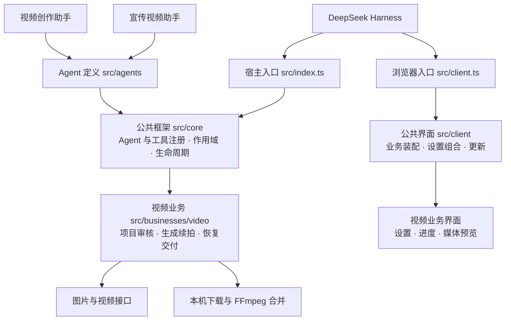

# MetaOnticVideo

[English](./README.en.md)

DeepSeek Harness 视频创作插件：**新手快速上手，低成本制作长视频。**

## 新手快速上手视频创作

不用先研究提示词或剪辑流程，把想拍的内容说出来，跟着助手完成第一条视频。

1. **说想法**：一句灵感或完整创意都可以，助手帮你整理；需要完善时沿着你的原意补充。
2. **看脚本**：先看懂要拍什么，再用口语提修改意见，满意后确认制作。
3. **看结果**：生成后直接预览，完成的视频保存到本机。

例如：“帮我做一条30秒竖屏720P的视频，表现清晨湖面的宁静。”已写明的时长、横竖屏和分辨率直接沿用，只询问缺失信息。

## 低成本长视频生成方案

通过 **分段生成 → 逐段续拍 → 本机合并**，把超过模型单段上限的创意做成长视频。

- 每段先看结果，确认后再续拍下一段，按段推进制作。
- 已完成的分段保留复用，可以暂停后接着做，避免从头重复生成。
- 全部分段完成后，用 FFmpeg 在本机合并，原始分段一并保留。

需要自行配置 API密钥；图片与视频按渠道实际用量计费，每段新增生成前确认费用。

## 在线安装

在 Harness「插件 → 添加插件」中粘贴在线安装链接。Windows 与 macOS 使用同一个成品。

Gitee：

```text
https://gitee.com/hackloop/metaontic-video/releases/download/v3.20.2/metaontic-video-3.20.2.tgz
```

GitHub 同版备用：

```text
https://github.com/wxsimon2022/metaontic-video/releases/download/v3.20.2/metaontic-video-3.20.2.tgz
```

安装后打开插件设置，选择 **MetaOntic AI**，填写 API密钥并保存；在会话中选择 **视频创作助手** 开始。制作产品、品牌或活动内容时，也可选择 **宣传视频助手**。这两个助手使用相同的制作流程，标准模式保持通用用途。

[在线使用说明](https://ai.mybfs.cn) · [问题反馈](https://github.com/wxsimon2022/metaontic-video/issues) · [完整更新记录](./CHANGELOG.md) · [开发说明](./docs/engineering/development.md)

## 插件架构

Agent 声明业务依赖，公共框架负责装配；两个现有助手共用视频业务。新增业务可独立接入，不必修改视频制作流程。



[目录结构与新增 Agent / 业务接入方式](./docs/engineering/structure-refactor.md)

<details>
<summary>最新更新</summary>

## v3.20.2 更新内容

### 优化

- 常规体验优化。

## v3.20.1 更新内容

### 优化

- 鉴权异常提供设置检查与客服入口，不再直接判定密钥无效；视频接口401/403准确提示鉴权失败。

</details>

许可见 [LICENSE](./LICENSE)。

### 无限画布

图片/视频节点的生成面板直接显示 MetaOnticVideo 当前接入、模型与密钥就绪状态，点击「生成并确认费用」开始；这些节点不再显示原版模型选择器。

视频创作面板提供原版 [`dsh-infinite-canvas`](https://github.com/NINKCH/dsh-infinite_canvas) 的安装与打开入口。安装后，在图片或视频节点内点击生成或重新生成，直接在画布确认制作方案和费用、查看并审核成果，无需打开助手或发送聊天。API密钥沿用本插件设置，不复制到画布。每个视频节点执行一段（2.0 最长15秒、2.5最长30秒），审核后选中成果填写新增内容续拍；图片暂支持1:1单张。成果新增回原画布，回填失败只补传，不重新生成。原版批量运行、右键运行和其他生成工具仍使用原版配置。也可在助手中使用 `video_canvas` 走完整脚本创作流程。适配原版无限画布0.20.1及更新版本，需设置画布数据根目录；已有安装不会自动替换。

普通视频创作会自动创建无限画布项目：确认创作需求后建立项目，脚本审核后同步完整剧本与各制作段计划，生成成果自动回填。无需手动建立节点或复制定位信息。需先安装并启用原版无限画布0.20.1或更新版本，并设置画布数据根目录；未就绪时创作项目仍保留，助手会说明同步状态，可查询项目状态重试同步。脚本审核、费用确认和分段成果审核仍按原流程执行。
