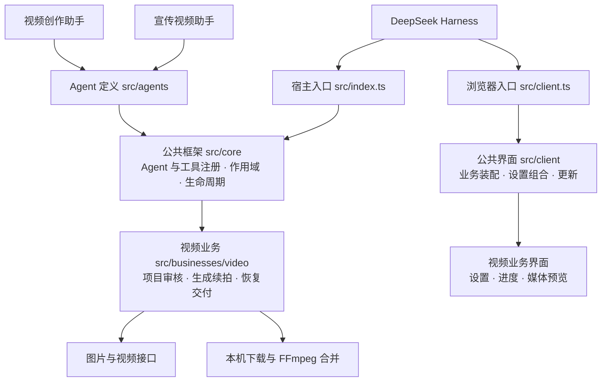

# MetaOnticVideo

[English](./README.en.md)

DeepSeek Harness 视频创作插件：**新手快速上手，低成本制作长视频。**

## 新手快速上手视频创作

不用先研究提示词或剪辑流程，把想拍的内容说出来，跟着助手完成第一条视频。

1. **说想法**：一句灵感或完整创意都可以，助手帮你整理；需要完善时沿着你的原意补足细节与画面层次，画面更有变化。
2. **看脚本**：先看懂要拍什么，再用口语提修改意见，满意后确认制作。
3. **看结果**：生成后直接预览，完成的视频保存到本机。

例如：“帮我做一条30秒竖屏720P的视频，表现清晨湖面的宁静。”已写明的时长、横竖屏和分辨率直接沿用，只询问缺失信息。

## 低成本长视频生成方案

通过 **分段生成 → 逐段续拍 → 本机合并**，把超过模型单段上限的创意做成长视频。

- 每段先看结果，确认后再续拍下一段，按段推进制作。
- 已完成的分段保留复用，可以暂停后接着做，避免从头重复生成。
- 全部分段完成后，用 FFmpeg 在本机合并，原始分段一并保留。

需要自行配置 API密钥；图片与视频按渠道实际用量计费，每段新增生成前确认费用。

## 在线安装

在 Harness「插件 → 添加插件」中粘贴在线安装链接。Windows 与 macOS 使用同一个成品。

Gitee：

```text
https://gitee.com/hackloop/metaontic-video/releases/download/v3.29.2/metaontic-video-3.29.2.tgz
```

GitHub 同版备用：

```text
https://github.com/wxsimon2022/metaontic-video/releases/download/v3.29.2/metaontic-video-3.29.2.tgz
```

也可以在 Harness「插件 → 发现」中添加插件市场索引源，浏览并安装：

```text
https://gitee.com/hackloop/metaontic-video/raw/master/market/index.json
```

安装后打开插件设置，选择 **MetaOntic AI**，填写 API密钥并保存；在会话中选择 **视频创作助手** 开始。制作产品、品牌或活动内容时，也可选择 **宣传视频助手**。这两个助手使用相同的制作流程，标准模式保持通用用途。

[在线使用说明](https://ai.mybfs.cn) · [问题反馈](https://github.com/wxsimon2022/metaontic-video/issues) · [完整更新记录](./CHANGELOG.md) · [开发说明](./docs/engineering/development.md)

## 插件架构

Agent 声明业务依赖，公共框架负责装配；两个现有助手共用视频业务。新增业务可独立接入，不必修改视频制作流程。



[目录结构与新增 Agent / 业务接入方式](./docs/engineering/structure-refactor.md)

<details>
<summary>最新更新</summary>

## v3.29.2 更新内容

### 优化

- 左侧栏的更新红点移到「视频创作助手」最后一个字的右上角，显示成角标；侧栏收起时红点仍在图标角上。

## v3.29.1 更新内容

### 优化

- 助手把工具参数写错（例如 480p 少了引号）导致这一轮失败时，会说明没有调用模型、也没有扣费，并提示按原参数重试。
- 清晰度写成 480、480P、720 这类写法都能正常识别，不再直接报错。

## v3.29.0 更新内容

### 优化

- 左侧栏的更新提示从文字改成一个小红点，跟在「视频创作助手」名字后面；侧栏收起时红点落在图标角上。

## v3.28.0 更新内容

### 优化

- 「帮我完善」会补齐场景与道具、动作层次、画面层次与节奏，成片画面更有变化，不再单调。
- 画布「AI 写脚本」会避免相邻分镜用同一组景别与视角，整片镜头不再重复雷同。

## v3.27.0 更新内容

### 新增

- 插件左侧栏入口查到新版本时显示「有更新」，侧栏收起时图标角上有小圆点。

### 优化

- 从提示打开的面板顶部即可更新，两步确认后安装最新正式版，点「稍后再说」只压住这一版。

## v3.26.0 更新内容

### 新增

- AI 写脚本的分镜表增加「视角」列，按场景为每个镜头挑视角，平视是默认，不硬加。

### 优化

- 视角与镜别、运镜一起写进每段提示词，画布分镜与镜头示意图同步显示。

## v3.25.0 更新内容

### 新增

- 正式版会同步发布到 GitHub，同一安装包多一个官方下载渠道。

## v3.24.2 更新内容

### 新增

- 流程画布可视化创作：七张阶段卡串起需求到成片，两步创作铺出剧本、分镜、画面与视频节点，脚本审核在画布完成。

### 优化

- 写脚本更快：分镜示意图本地渲染、脚本只写一次；连拍跳过已有成果的段，不重复生成与计费。

## v3.24.1 更新内容

### 优化

- 匿名使用统计口径更准确，画布等工具的调用会被计入，测试版不再计入统计。

## v3.24.0 更新内容

### 新增

- AI 写脚本的分镜表增加镜号、镜别、运镜三列，画面列要求写全主体、动作、环境、光线与氛围。

### 优化

- 分镜表里的镜别与运镜会带进每段提示词，画布分镜节点按镜别·运镜加画面详情显示。

## v3.23.0 更新内容

### 新增

- 设置页新增「自动创建画布」开关（默认开启），可关掉自动建图，只在画布内选中的节点上联动。

### 优化

- 流程画布拆成「流程画布」与「自动创建画布」两个开关，先打开流程画布才会出现自动创建。

## v3.22.0 更新内容

### 新增

- 流程画布可直接导入自己的图片作素材，连成首帧或参考图参与制作。
- 全部段落出成果后可一键合成成片，在画布内预览或下载。

### 优化

- 流程画布开关关闭后左侧栏不再显示画布入口，已有画布与成果保留。

## v3.21.0 更新内容

### 新增

- 内置流程画布：独立页面管理画布与连线，图片视频节点直接制作、续拍。
- 画布内写脚本铺开剧本分镜，「连拍」一次确认后逐段生成并逐段审核。

### 优化

- 不再需要第三方画布插件；自动创建画布默认关闭，文本模型可单独配密钥。

## v3.20.2 更新内容

### 优化

- 常规体验优化。

## v3.20.1 更新内容

### 优化

- 鉴权异常提供设置检查与客服入口，不再直接判定密钥无效；视频接口401/403准确提示鉴权失败。

</details>

许可见 [LICENSE](./LICENSE)。
