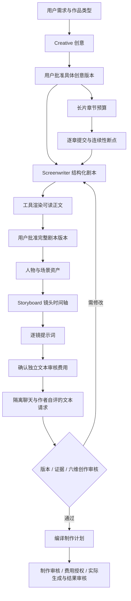

# 创作质量架构与验证

## 运行链路

八个角色仍是专业职责，不假称宿主注册了八个独立执行器。Reviewer 有真实独立文本请求；其余角色由宿主按 nextTask 的当前角色指令执行。独立请求默认沿用当前文本模型，隔离上下文不等于换了另一种模型。

## 已接入的约束

- 新项目 canonical_v1：scenes、beats、dialogue 为剧情来源。beats 按动作与对白顺序排列，key_actions 由动作节拍派生，screenplay 由工具渲染；旧项目保持兼容。局部 revise 支持场次、对白、人物、章节，保留无关实体，变更后清除相应批准、失效下游。
- 新项目 chapter_v1：10分钟以上先保存章节预算。chapter_submit 保存本章草稿、依赖版本、既定事实、人物状态与悬而未决线索；前章改动清除后章同阶段草稿。全章汇总通过整片校验后才创建全片产物，不把部分完成当完成。剧本仍是整片审批，不增加虚构的逐章批准。
- 新项目 isolated_v1：independent_review 在费用同意后执行真实文本请求；review_context 只读，不代表审核已执行。大型上下文按完整章节审核，每次提供全片结构与连续性摘要，汇总保留逐章来源。过大的单章明确拒绝，不能静默截断。原子保存已完成请求的报告；恢复会复用同一输入/模型/地址/提示词版本的断点，不自动重做成功请求。未完成或结果不明的请求再次执行仍需费用确认。
- 审核要求八维评分、适用 Profile 证据，以及主题表达、因果推进、人物可信度、对白功能、视觉具体性、结尾回收六维证据。艺术项由评阅者提供场次依据；程序只校验引用、覆盖、预算等可复算事实。runtime receipt 绑定报告摘要与依赖版本，手工添加“已执行”标识不能替代真实请求。
- 阶段上下文按直接依赖组合，局部镜头任务仅提供相关镜头与场次。记录指令字节、输入字节、摘要与明确标注的 token 估算；实际用量仅采用接口 usage。资产登记仍可通过只读工具完整查阅。
- 严格 TypeScript 从核心契约、剧本文档渲染、审核判定开始，typecheck 同时执行原项目与 strict 子项目；未声称所有旧模块已消除 any。
- 能力按渠道模式、接入地址摘要和模型隔离。本地适配器声明保持 ADAPTER_DEFINED；真实成功任务仅保存任务ID、规格样本、时间，不存凭据/提示词/媒体地址。样本最多256条，不由单次成功推断上限。更换接入地址后，configure_profile 确认并重检资产及下游，再审核、编译。

## 离线质量评测

`npm run eval:film -- cases` 列出喜剧、生活、广告、宣传、纪录与长片六类固定题；`npm run eval:film -- candidate.json report.json` 复算事实并检查评阅证据。候选包含 case_id、script，可选 assessment。未提交评阅证据的艺术结论始终为 NOT_EVALUATED，不生成“自动专业级”结论。

相关回归在 tests/film-architecture.test.mjs、tests/film-global-improvements.test.mjs，覆盖拒绝付费零请求、真实工具到模拟 HTTP 的独立审核、正文同源、章节恢复、局部修改、版本防伪、长稿分章审核、上下文范围、渠道隔离与日志隐私。模拟结果不代表真实模型质量已提升，仍需使用同题稿件与人工试听/观看比较。

## 平台与付费验证范围

文件路径通过 node:path、导入通过 pathToFileURL，用户状态沿用宿主数据目录；断点使用私有文件和原子替换。两平台共享同一 tgz。开发机的 macOS 自动化及本地安装不能代替 Windows 桌面验证；本次没有调用真实付费生成接口，也没有伪造真实视频验收。
