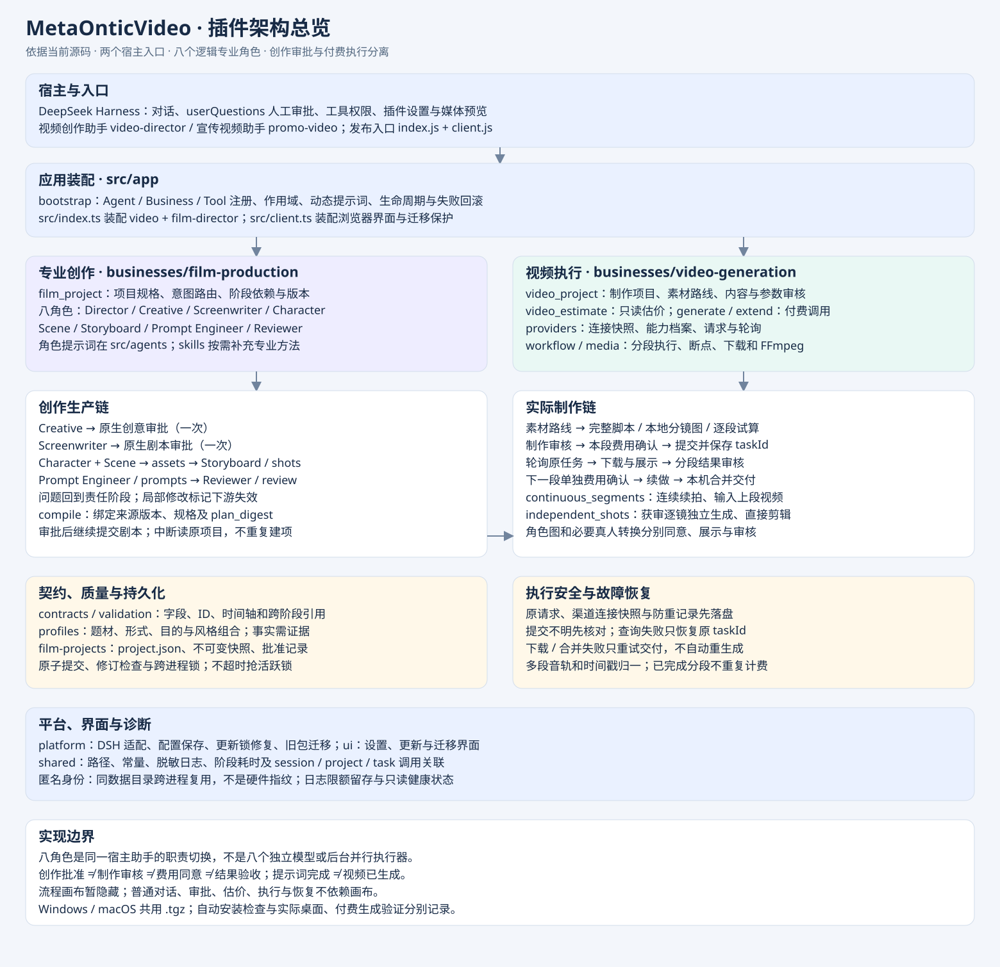

# 插件架构与制作流程

依据当前源码更新。总览图展示分层与边界，Mermaid 源码展示完整创作、执行和恢复链路。

- [SVG 矢量图](./plugin-workflow.svg)
- [可编辑 Mermaid 流程源码](./plugin-workflow.mmd)
- [源码分层说明](./structure-refactor.md)
- [影视创作模块映射](./film-director-architecture.md)

## 装配与角色

`src/index.ts` 通过 `app/bootstrap.ts` 装配 `video` 与 `film-director` 两个业务，注册「视频创作助手」一个宿主预设。该助手可创作剧情、风景、产品及品牌宣传等不同类型内容。`src/client.ts` 装配浏览器界面及安装迁移保护。专业提示词位于 `src/agents/<role>/prompt.ts`，由 `film-production/roles` 加入当前阶段契约、类型配置和专业方法；`skills/` 提供按需参考。

Director、Creative、Screenwriter、Character、Scene、Storyboard、Prompt Engineer、Reviewer 是同一宿主助手的八个逻辑职责，不代表八个独立模型、后台任务或自动并行调用。

## 创作与制作

完整专业创作由 `film_project` 管理：创意 → 创意批准 → 剧本 → 剧本批准 → 人物与场景资产 → 分镜 → 提示词 → 终审。两个批准节点直接使用工具原生审批窗，同版本已批准后不重复弹窗；中断读取原项目继续尚未提交的剧本。Character 与 Scene 当前共同提交 `assets`。

创作数据支持15秒至60分钟规划；4–14秒、用户明确快速草案或已有普通制作项目沿原制作入口继续。规划时长不代表模型单次请求时长。`compile` 核对模型、规格和实际分段，绑定来源版本及 `plan_digest`，交给 `video_project` 制作。

制作项目处理参考素材路线、完整脚本、本地分镜示意图与费用试算。制作审核后仍需单独同意费用。默认连续分段续拍；经过选择和审核可使用逐镜独立生成。每段结果展示、确认后才继续下一段费用审批，最终本机 FFmpeg 合并或单段交付。图片生成与必要真人转换有独立同意及审核边界。

## 状态、安全与恢复

创作项目使用原子状态提交、不可变快照、修订检查、批准记录与跨进程锁；只有确认已退出的本机进程锁可恢复。实际生成先记录原请求与防重状态，保存 taskId 后轮询原任务。提交不明先核对渠道；查询、下载和合并失败不能触发重新生成。

`platform/` 负责宿主适配、配置、安装更新、迁移及匿名遥测；`shared/` 负责通用路径、脱敏日志和阶段诊断。匿名身份只对应宿主数据目录，不是硬件指纹。流程画布代码和接口已移除，普通对话创作与执行独立工作。

Windows/macOS 共用成品包；自动安装与升级检查不等于桌面实机或付费生成验证。分层图与流程文档更新不改变运行行为，不单独发版。
