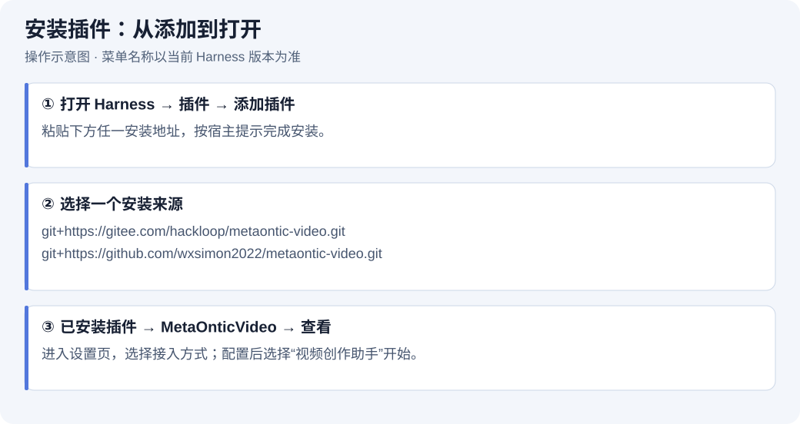
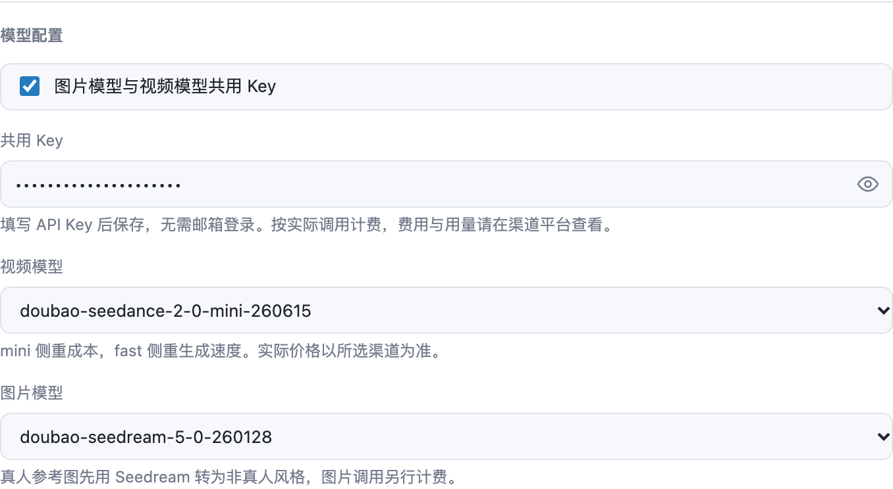
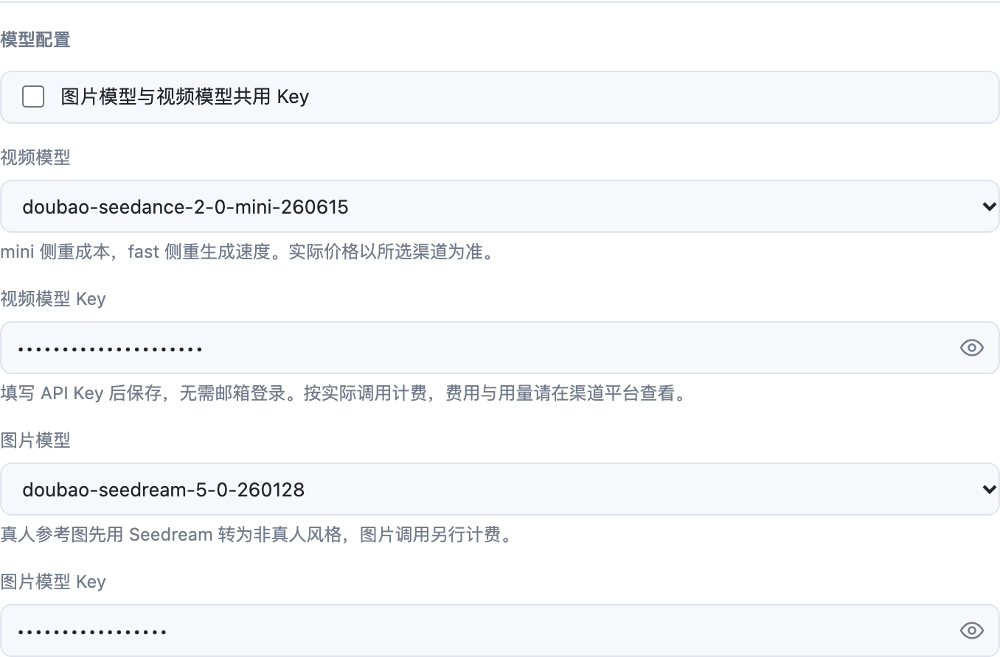
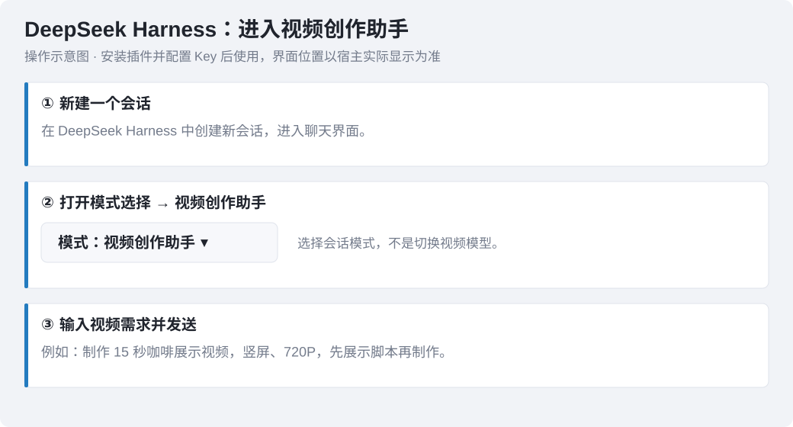
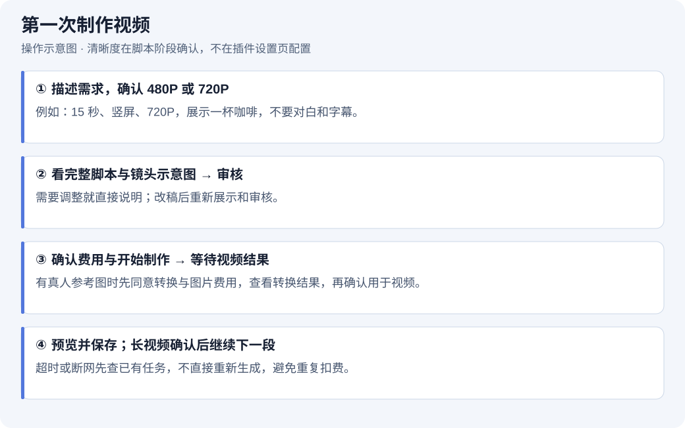

# MetaOnticVideo 安装与使用指南

先安装插件并配置 Key，再新建会话，将模式切换为“视频创作助手”，开始制作视频。Key 配置配图来自插件真实组件的本地预览，使用模拟数据且密钥已隐藏；安装、会话与制作流程采用操作示意图，菜单名称以当前 Harness 版本为准。

## 1. 如何安装插件



打开 DeepSeek Harness 桌面端，进入「插件 → 添加插件」，粘贴以下任一地址，按提示安装：

```text
git+https://gitee.com/hackloop/metaontic-video.git
```

或使用 GitHub 地址：

```text
git+https://github.com/wxsimon2022/metaontic-video.git
```

安装后进入「插件 → 已安装插件 → MetaOnticVideo → 查看」，打开设置页。

也可以在 [GitHub Releases](https://github.com/wxsimon2022/metaontic-video/releases) 或 [Gitee Releases](https://gitee.com/hackloop/metaontic-video/releases) 下载 `metaontic-video-<版本>.tgz`，解压后安装其中的 `package` 目录。终端安装示例：

```bash
dsh plugin --profile desktop add /你的路径/package
```

安装后按宿主提示启用插件；只有宿主明确要求时才重启。

## 2. Key 去哪里申请

需要自行申请 Key 时，目前按以下入口操作：

**[https://ai.bileego.com/](https://ai.bileego.com/)**

1. 打开网站，注册并登录账号。
2. 按网站当前页面指引获取 API Key。
3. 确认账户可用额度，以及该 Key 是否有你准备使用的视频、图片模型权限。
4. 回到插件，选择 **MetaOntic AI**，按下一节填写并保存。

申请到 Key 后，在插件的接入方式中选择 **MetaOntic AI**。

Key 只填写在插件密钥输入框内，不要放进脚本或发到聊天中。

## 3. 选择 MetaOntic AI 并配置 Key

1. 在接入方式中选择 **MetaOntic AI**。
2. 根据下面两种情况配置 Key。
3. 选择视频模型和图片模型，完成后点击保存。

**情况一：两个模型共用一把 Key**



保持开启「图片模型与视频模型共用 Key」。在两个模型上方的 **共用 Key** 中填写从网站获取的 Key，再选择视频模型和图片模型。这把 Key 必须同时支持你选择的两种模型。

排列顺序：共用开关 → 共用 Key → 视频模型 → 图片模型。

**情况二：视频和图片分别使用 Key**



关闭「图片模型与视频模型共用 Key」：

- 在视频模型下方的 **视频模型 Key** 中填写视频用 Key。
- 在图片模型下方的 **图片模型 Key** 中填写图片用 Key。

排列顺序：共用开关 → 视频模型 → 视频模型 Key → 图片模型 → 图片模型 Key。

独立图片 Key 未填写时，图片调用会停止并提示补填，不会自动改用视频 Key。图片提交、查询和取件均使用图片 Key；视频生成、重试和状态查询使用视频 Key。

两个模型仍沿用当前 MetaOntic AI 接入地址，分别填写 Key 不代表分别配置接口地址。MetaOntic AI 按渠道账户实际调用计费。

## 4. 在 DeepSeek Harness 中开始使用



安装插件并保存 Key 配置后，按以下步骤进入视频创作：

1. 在 DeepSeek Harness 中**新建一个会话**。
2. 打开会话的**模式选择**，将模式改为 **视频创作助手**。
3. 在输入框中描述你要制作的视频；需要参考图时，在会话中上传图片并说明用途。
4. 发送需求后，按助手提示确认清晰度、审核脚本，再确认是否开始制作。

这里的“视频创作助手”是会话模式，不是插件设置里的视频模型。若模式列表里没有它，先检查 MetaOnticVideo 是否已安装并启用，再重新打开模式列表；只有宿主明确要求时才重启。

### 第一次生成视频



切换到「视频创作助手」后，可以直接说：

> 帮我做一个 15 秒的咖啡展示视频，竖屏，720P，温暖自然，不要对白和字幕。先展示脚本，审核后再制作。

操作顺序：

1. 描述需求或提供完整方案。需要助手完善时直接说“帮我完善”；已有完整方案时可要求“只润色，不改变剧情、角色和结尾”。
2. 确认清晰度：目前支持 **480P、720P**，在脚本阶段选择，不在插件设置页配置。本次需求已明确指定就不重复询问；未回答或取消时不开始制作。未指定时长与画幅时，默认 15 秒、9:16。
3. 查看完整脚本和镜头示意图，再确认脚本是否通过。示意图不是实际成片，默认不调用付费出图模型。
4. 脚本通过后，单独确认费用与是否开始制作。按 MetaOntic AI 渠道账户实际调用计费。
5. 等待生成，预览并保存结果。改稿后需要重新展示、审核并确认制作；普通改稿保留已确认清晰度，改变清晰度须重新确认。

### 使用参考图

上传图片并说明用途，例如“用这张图保持人物外观”或“这张作为视频第一帧”。多图需说明各自对应的人物、商品或场景；参考图与首尾帧模式不能混用，尾帧必须配首帧。

真人参考图需要先确定非真人风格，并征得你对图片处理及其费用的同意。处理完成后先展示全部转换图，等你核对并确认后再用于视频。图片生成单独计费；效果不合适或仍像真人时停止，不使用原真人图重试。

视频接口返回明确真人限制时，也遵循“同意转换 → 看转换结果 → 确认重试”流程，最多重试视频一次；图片与视频重试分别计费。部分图片已完成时会保存结果，续做不从头处理。

图片模型支持 `doubao-seedream-5-0-260128` 和 `doubao-seedream-5-0-pro-260628`，能否调用以 Key 的实际模型权限为准。

### 长视频与中断恢复

超过模型单次上限时，插件分段制作。每段完成先展示视频，你确认后再继续下一段。Seedance 2.0 单次 4–15 秒；2.5 保留兼容，但设置页暂不提供新候选。

暂停后可说“接着刚才的进度继续，不要重做已完成片段”。超时、断网不一定表示生成失败，先查原任务，避免重新提交。

提交结果不明时插件会阻止重复提交。保留返回的任务或提交记录，让助手协助核对渠道记录；找到原任务则继续查询，只有你在渠道确认没有创建任务后才能解锁。不要通过修改参数或清除记录绕过防重。

未完成任务继续使用原来的参数与连接配置；请保留原接入方式、地址和 Key，不要在等待期间切换。同一份暂停进度不要同时续做多次。

## 5. 结果保存与常见问题

生成结果默认保存在当前会话工作目录下的 `metaontic-video/`，助手会展示视频并说明实际路径。原始分段保留，脚本等资料通常在 `video-projects/<项目名>/`。如只返回上游链接，需在链接失效前保存。

多段本地合并需要 ffmpeg；缺少时可说“帮我检查并安装 ffmpeg”，确认安装后继续。高级设置中的合并、裁剪、等待时间通常保持默认即可；裁剪可能缩短成片，原始分段不删除。

需要重新配置时，可使用“重置插件”清除设置、密钥和登录状态；已生成的视频不会删除。

| 遇到的问题 | 如何处理 |
| --- | --- |
| 网站申请的 Key 不知道填哪里 | 选择 MetaOntic AI；共用时填“共用 Key”，不共用时分别填两个模型下方的 Key |
| 图片提示缺少 Key | MetaOntic AI 关闭共用后必须填写图片模型 Key 并保存 |
| 提示无权调用模型或鉴权失败 | 检查对应模型的 Key 是否正确、是否开通模型权限，修改后保存 |
| 提示额度不足 | 到申请 Key 的平台核对对应账户额度并按平台指引充值 |
| 只生成第一段 | 先预览，再确认从暂停进度继续 |
| 超时、网络失败或提交结果不明 | 保留原任务与记录，先查询或核对，不直接重新生成 |
| 只给脚本文件就要求审核 | 要求先完整展示当前版脚本和镜头示意图，再重新审核 |
| 没有清晰度选项 | 清晰度在对话里的脚本阶段确认，支持 480P / 720P |
| 保存失败 | 保留错误信息，重新打开设置检查；仅宿主明确要求时重启 |

更多能力与参数说明见 [README.md](./README.md)。
